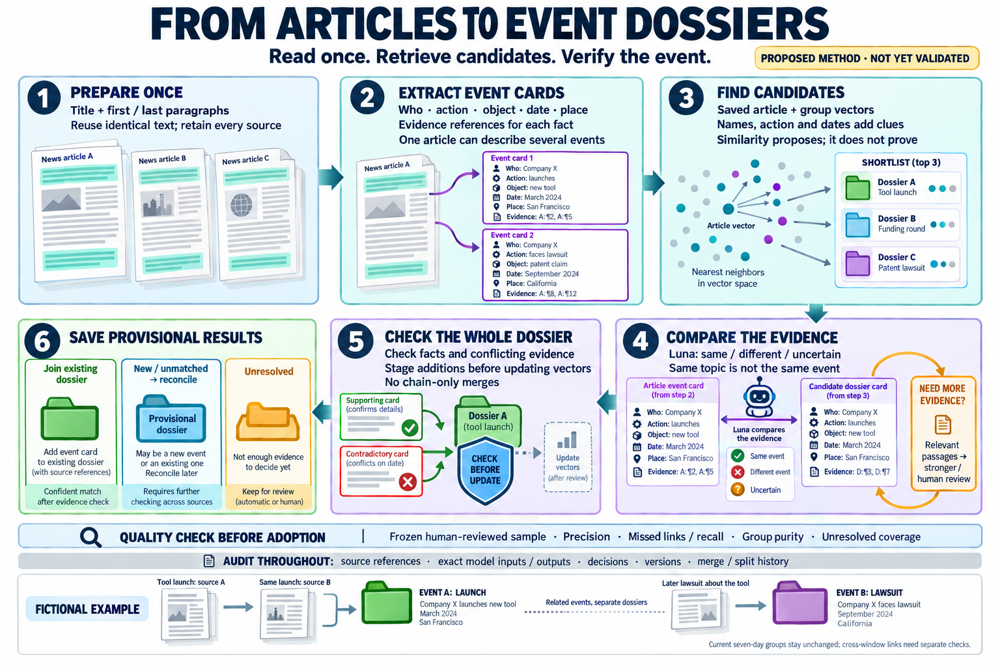

# Excerpt-first event mapping — proposed design v1

Date: 2026-10-17. Status: **method design and illustration, not an executed
corpus experiment or a validated grouping policy**. No corpus sources were
inspected, no research model judgments ran and no memberships changed for this
design. Native assistant design review and built-in image generation are not
gateway-audited article inference. The drawing uses fictional examples only.

## What improves on the initial cost sketch

The unit is an **event mention**, linked to one specific real-world event.
One article can describe several events and therefore support several dossiers.
Similar subjects, companies or technologies do not establish event identity.
The method first extracts source-backed facts, then retrieves candidate events,
then compares evidence. It never treats similarity as a probability of identity.

Missing retrieval is not proof of novelty. An unmatched mention remains a
**provisional new/unmatched event**, pending reconciliation, rather than
automatically increasing an accepted event count. Proposed additions are staged
before dossier profiles or vectors change, preventing one mistaken addition from
attracting further matches. Positive A-B and B-C links alone cannot justify A-C.

## Proposed steps

1. **Prepare once.** Build a bounded packet from the title and first two / last
   two meaningful source paragraphs, removing overlapping selections. Preserve
   exact passage references and document versions. Boilerplate detection must be
   explicit and versioned, with omissions retained. Reuse identical text only
   with exact, version-bound cache provenance; preserve every publisher,
   publication date and source version. Missing or quarantined text remains
   unprocessed. These packet settings are proposals, not measured optimal values.
2. **Extract evidence-backed event mentions.** Luna produces separate primary
   and background mentions with actor, specific action, affected object, event
   date or range, place when available and evidence per fact. Unknowns remain
   null; publication date does not stand in for event date. Store claims and
   uncertainty without implying that the reported event is independently proven.
3. **Retrieve a broad shortlist.** Reuse compatible saved passage/article
   vectors and body-deduplicated group centroids. Combine candidate lists with
   entity/action/date and provider-ID signals; absent facts are not automatic
   exclusions. Keep diverse source exemplars alongside the collective vector.
   The picture's three candidates are illustrative, not an adopted top-k cutoff.
   New event-card embeddings, if desired, would be a separate registered cost.
4. **Compare identity using evidence.** Supply the mention, candidate event
   profiles and source excerpts to the cheap model. Retain `same_event`,
   `different_event` and `uncertain`, with evidence and candidate alternatives.
   A no-candidate case stays unmatched; a failed model attempt stays unprocessed.
   If the excerpt cannot resolve identity, retrieve relevant middle passages,
   then consider full text or stronger/human review. Missing evidence is not a
   negative finding. Model confidence is not a calibrated probability.
5. **Check whole-dossier consistency before updating.** Stage proposals against
   frozen event profiles, source-backed facts and known negative/uncertain
   relations. Review apparent date/place conflicts with their precision and
   uncertainty; reports can disagree about the same event. A centroid or one
   representative article cannot alone establish consistency for every member.
   Any unresolved conflict blocks automatic inclusion. Freeze a batch, reconcile
   its proposals and only then version its profile/vector. Preserve merge/split
   history and corrections; never silently rewrite old membership.
6. **Keep provisional results separate from acceptance.** Store an existing-event
   proposal, a provisional new/unmatched event, or an unresolved membership.
   Reconcile unmatched mentions across the batch and against existing events to
   reduce order-dependent duplicate dossiers. If this introduces new candidates,
   repeat identity and consistency checks. Acceptance requires a predefined,
   versioned policy or identified reviewer and valid evidence. Count reviewed
   event dossiers, with unresolved and unprocessed coverage beside them.

The current guarded **seven-day groups remain unchanged**. This design does not
adopt different windows. Retrospective/long-gap reports can be proposed for a
separate source-checked cross-window linking tier; related later actions remain
distinct events. A launch and a subsequent lawsuit are separate dossiers even
when they concern the same company and product.

## Validation, speed and audit

Freeze an independently human-annotated event-level development/held-out split
before tuning the new pipeline. Keep syndicated copies, related event mentions
and multi-event bridges from leaking between splits. Include independently
identified same-event links outside retrieved neighbors, similar-topic different
events, singletons, retrospective reports and multi-event articles.

Report candidate recovery, pair precision, missed-link/recall estimates,
whole-dossier purity, false splits and event-count error within the annotated
frame. Report decisive coverage, uncertainty, technical failures and confidence
intervals separately. If a corpus-wide quality estimate is claimed, use a
registered probability sample with denominators and exclusions; a curated
challenge set does not establish population accuracy. LLM references are not
human gold. The previous experiments did not demonstrate 90% precision, and
this design provides no new accuracy result.

For speed, cache exact extraction results; use local candidate search; compare
compact event profiles; batch independent frozen packets; and expand evidence
only where needed. Consistency checks still cover each proposed member. They
must not become a metadata-only substitute for evidence or required integrity
checks. More reading and stronger review have unknown frequency and cost.

All future research execution must use `Research.execute()` and the shared
gateway, with a registered method, frozen packets, dataset/prompt/model versions,
intent/results, stable task IDs, retries/unknown outcomes, evidence and decision
history in protected storage. No credentials or source-bearing payloads enter
Git. This design is not API execution authorization.

## Implementation and budget limits

This diagram describes the intended system. A compatible multi-mention data
model, API extraction/mapping transport, batch reconciliation, acceptance policy
and independent validation still need implementation or integration. Existing
source-to-dossier exclusivity cannot represent all of these memberships; see
the [event-dossier scope](INCIDENT_DOSSIER_METHOD.md#current-scope-event-dossiers--2026-10-15).
Full compatible vector coverage also remains unfinished.

The earlier [cost estimate](EVENT_MAPPING_COST_ESTIMATE.md) remains an assumed
two-stage token budget, with a compact 5% stronger-model check example. The extra
evidence expansion, reconciliation and group checks proposed here have not been
token-counted or priced. The USD 100-150 Batch allowance is not a validated quote
for this expanded design. Prepare exact packets and a bounded execution plan
before seeking paid-run approval.

The diagram was created with the built-in image-generation tool, visually
checked for labels and flow, and copied into the repository. The exact
[generation prompt](EVENT_MAPPING_DIAGRAM_PROMPT.md) is retained. This checks
presentation only, not scientific validity or model performance.
