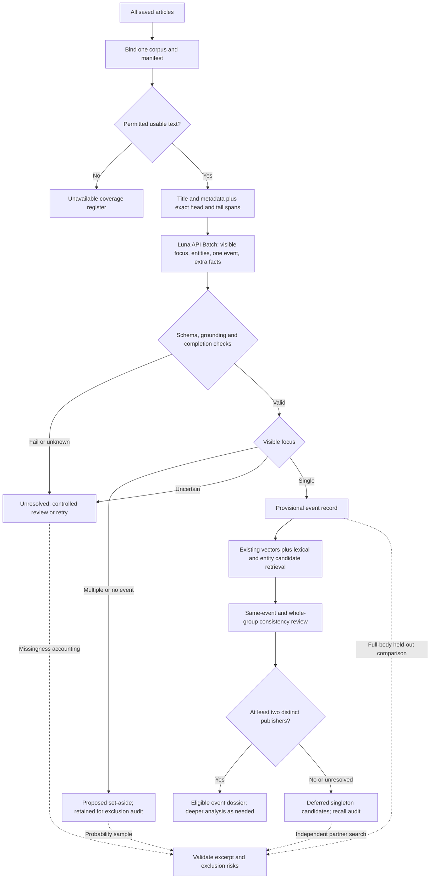

# Luna excerpt screening and event extraction

**Historical v1.** The current proposed input and entity contract is
[full retained text with compact event extraction, v2](LUNA_EVENT_METHOD_V2.md).
The v1 files and measured workload below remain unchanged historical evidence;
their token costs do not price the new v2 prompt/schema or output distribution.

Status: proposed inference method, with implemented offline excerpt construction,
prompt, JSON Schema, validators and workload audit. No Luna execution, batch
upload, new embeddings, article exclusions or dossier membership changes are
authorized or performed by this specification. The earlier stopped extraction
pilot remains stopped. This is a new contract and study lineage.

The objective is to minimize article-processing work while retaining reports
about one focal event that can support a dossier with at least two different
publishers. An incident is a possible event subtype, not a requirement for harm.
Cybercrime and incident-reports stay separate before selection, caching,
retrieval, inference, grouping and evaluation. Collection labels do not prove
that an article is eligible.

## Operational decision

An event is a particular reported occurrence, action, decision or bounded
continuing episode, identifiable through what happened and its participants,
with time and place when available. Missing an exact date or place does not
make it a non-event. Distinguish a real reported allegation from independently
established truth. An event can be reported as planned or denied; factuality
is a separate variable, not an implicit positive finding.

| Focus label | Decision rule | Handling |
| --- | --- | --- |
| single | One clear focal occurrence in the supplied evidence | Extract one provisional event and its facts |
| multiple | At least two distinct, substantively coequal occurrences; roundup or review without one dominant occurrence | Propose set-aside from analysis; retain evidence and original source |
| no_event | General trend, tutorial, standing capability, opinion or thematic comparison without a focal occurrence | Propose set-aside; preserve decision evidence |
| uncertain | Evidence does not resolve focus or granularity | Defer; targeted full-text review |
| unavailable / invalid / pending | Application processing states, outside the model label enum | Never convert to no_event or exclude as irrelevant |

Background, consequences and reactions can accompany one focal event. Count
focal occurrences, not verbs, named entities or dates. An attack described with
historical context can be single. A later judgment concerning that attack is
a distinct focal event when the judgment is the news. An announcement and the
future action announced are not automatically the same occurrence. A connected
campaign does not justify merging distinct coequal attacks. These boundary
cases require examples in development and independent assessment in evaluation.

The model judges the **visible evidence**. `evidence_basis=excerpts` must never
be reported as full-article verification. Even a perfect excerpt classifier
cannot discover an unrelated event present only in the omitted middle. A
`full_body` flag means all retained nonwhitespace body text was supplied;
it does not establish that the saved body is the publisher's complete original.

## Inputs and the two competing excerpt rules

Recommended candidate: exact title, saved language/publication metadata,
publisher metadata clearly marked as context, and the first 300 plus last 300
whitespace-delimited words. If the body has at most 600 words, send it once in
full. Merge overlap. Preserve exact Unicode slices, original offsets and hashes.

Comparison candidate: first and last nonblank paragraph, each capped at 300
words. Take the beginning of the first paragraph and the **end** of the last.
This implementation defines paragraphs by blank lines, including CRLF; single
newlines remain inside a paragraph. Paragraph formatting is a source of
variation. Interior paragraphs remain omitted even in articles below 600 words.
No semantic boilerplate removal or sentence completion is silently added.

The 600-word allowance excludes title, metadata, prompt and schema. A whitespace
word is not an API token; long identifiers and malformed text can be expensive.
Missing metadata is explicit. Provider categories, concepts and event IDs remain
available for retrieval/audit but are not supplied as authoritative entity or
event labels. Article IDs, URL, corpus/manifest identity, source hash, extraction
rule, model/prompt/schema versions and attempt status belong in the application
envelope, rather than being regenerated by Luna.

Exact packet reuse is valid only within one corpus and identical input, model,
parameters, prompt/schema and source-coverage contract. Rebind evidence to every
source appearance. Similarity, equal titles or equal bodies with changed context
do not establish interchangeable outputs or independent reporting. No cache
savings are assumed in the main cost comparison.

## Extraction codebook

| Entity type | Useful content and suggested subtypes |
| --- | --- |
| organization | Company, public institution, regulator, court, university, nonprofit, media |
| person | Named individuals; distinguish participant from quoted expert |
| place | Country, region, city or named location; headquarters is not automatically event location |
| product_system | AI model, service, platform, software, device, named infrastructure |
| threat_actor | Named attacker, collective or campaign actor |
| malware | Named malware family or attack software |
| legal_instrument_case | Named law, regulation, court case or legal instrument |
| identifier | CVE, case number, product version or comparable explicit identifier |
| other_named | Named facility, report, study, dataset or other object not covered above; record subtype |

This is a compact project codebook, not a claim that these are the empirically
optimal labels. Existing provider concept-type counts supply a coverage
diagnostic; they do not validate new NER. Entity type and role are distinct:
agent, affected party, authority, location, product or other. Mark each mention
as focal, background or uncertain. The publisher is not automatically an actor.

For `single`, extract one event summary, broad action category, exact trigger,
participants/roles, literal time expression and source claim status. Keep
named claim attribution separately; a background quoted source can be the
claimant. Each role has evidence and one entity can have multiple distinct roles.
Unknown attribution stays null and is never inferred from publisher metadata.
Preserve publication, disclosure and occurrence time separately. Do not infer the
occurrence date from publication metadata. Shared people, organizations, CVEs
or topic are candidate retrieval signals, not proof of event identity.

Additional variables use an **array of records**, not arbitrary JSON keys:
predicate name, subject reference, value type, literal value, optional normalized
number/date, unit, claim status and evidence. Examples include affected_count,
loss_amount, technical_method, sector, legal_basis, response_action and outcome.
Names can be new; later harmonization maps synonyms through a separately
versioned codebook while retaining originals. Values must be explicit in supplied
text. An empty array means no facts extracted under this contract, not no facts
in the full article. A null field means not established from this evidence.

The current limits are 24 named entities and 16 additional facts, with explicit
overflow flags. These are cost controls that require evaluation; false overflow
flags do not prove exhaustive recall. Rich facts are conditional on `single`;
other labels retain short focus evidence and named entities. If output cost
dominates, evaluate a separate minimal screening-only first pass rather than
assuming it is cheaper: it adds a second input request for survivors.

## Concrete contract and validation

- [Exact prompt](../prompts/luna_excerpt_v1.txt)
- [Strict JSON Schema](../schemas/luna_excerpt_v1.json)
- [Grounding validator and fictional fixture](../scripts/luna_excerpt_contract.py)
- [Machine-readable fictional input/output example](../examples/luna_excerpt_output.synthetic.json)
- [Deterministic excerpt rules](../scripts/luna_excerpt_windows.py)
- [Audited offline workload runner](../scripts/audit_luna_excerpts.py)

Core instruction: classify **single / multiple / no_event / uncertain** from
supplied evidence; preserve background versus focal roles; never infer omitted
content; for single extract one event plus named entities and explicit extra
facts; cite exact unchanged text for every literal assertion; distinguish
normalized values and paraphrases from literal source spans.

The application must verify input spans against immutable source versions,
validate the JSON Schema, resolve exact quotes to source offsets, validate local
IDs and cross-field consistency, and retain all rejected outputs and failures.
Repeated identical quotes retain all possible offsets until disambiguated.
Normalized names and event summaries need not equal the quote verbatim. This
addresses the earlier pilot's surface-versus-normalization failure without
relaxing literal grounding. Correct spelling/offsets do not prove entailment,
factuality, role correctness or focus accuracy. Numeric/date normalization still
requires semantic validation; the present checks do not prove conversions right.

The fixture is explicitly fictional and demonstrates shape only. Synthetic
tests establish software behavior, not extraction quality. This new contract
has not been tested against a live API's schema acceptance or model outputs.

## Batch API and cost control

Use `gpt-6-luna` through the OpenAI API with one article per request and strict
Structured Outputs. Batch means many separate requests in an asynchronous file;
it does not require packing multiple articles into a single model context.
Candidate parameter: `reasoning.effort=none`, evaluated against a small low-effort
alternative before freezing. Include an explicit output-token ceiling, but do
not equate the 400/800/1,600 average-output scenarios with that ceiling. An output
limit hit is incomplete processing, not a successful shortened extraction.

On 2026-10-17 official short-context Luna rates are $0.10/M input and $0.50/M
output for Standard; Batch is $0.05/M and $0.25/M. The estimate uses API-key
metered billing, not an assumption of free ChatGPT subscription usage. It does
not verify account access, credits, queue capacity or eligibility. Reasoning
and other billed output must be included in actual usage reconciliation.

The cost formula is `(input_tokens*0.05 + output_tokens*0.25)/1_000_000` for
the documented Batch short-context scenario. Prompt/schema and repeated input
context count. No cached-input discount, taxes, region uplift, retries, human
review, grouping or full-text escalation is assumed. Current local tiktoken
does not map the exact model alias: the audit explicitly uses verified cached
`cl100k_base` as a token **proxy**, not exact billing. The measured maximum and
a conservative 32,000-proxy-token manual-check flag prevent assuming word count
guarantees a small request; 32,000 is not a provider price boundary.

Official Batch limits include 50,000 requests and 200 MB per file, a 24-hour
completion window, and account/model queue limits. Split by both serialized
bytes and queued tokens, not just row count. Responses may be unordered; use
stable unique `custom_id` values. Reconcile every requested ID, observed model,
usage, refusal, error, expired request and missing outcome before considering
retries. A submitted asynchronous batch cannot promise a global first-invalid
stop: other requests may already execute. Run contract canaries first, then
bounded waves. Do not resubmit unknown outcomes automatically.

Production integration still requires a new audited gateway Batch lifecycle:
prior immutable plan and authorization, durable per-request reservations before
upload/dispatch, exact retained payloads and response files, recovery by provider
batch ID, result validation, complete coverage and bounded version-bound retry
decisions. Existing stopped or completed Luna queues cannot supply permission
or be silently repurposed. This document does not claim that adapter exists.

## Validation before exclusion

Develop examples and freeze the prompt separately from evaluation. Compare the
two excerpt rules on the same held-out article families. Group duplicate and
syndicated families before splitting so nearly identical text does not leak.
Independent reviewers inspect complete retained text, initially blinded to
excerpt decisions; keep disagreements and unresolved cases, then adjudicate.

Predefine primary risk targets and sampling probabilities. Stratify sensibly
by corpus, language, omission fraction/body length, missing provider metadata
and output label; avoid a sparse full cross-product. Use sampling weights for
unequal sampling and clustered uncertainty for related reports. Report:

1. Full-text non-single rate among excerpt `single` results.
2. Eligible single-focus reports among proposed `multiple`/`no_event` exclusions.
3. Eligible-report retention across the frame, uncertainty/escalation rate and
   unavailable/invalid/pending fractions.
4. Entity and fact precision/recall within supplied evidence, separately from
   full-body information coverage; event, time, attribution and factuality errors.
5. Event-level retention after the two-publisher requirement, including partners
   found independently of the production retrieval shortlist.

For orientation, zero errors in 59 independent decisive observations gives an
unadjusted one-sided 95% binomial upper bound below 5%; 299 gives below 1%.
Those are best-case sample-size illustrations, not demonstrated targets, fixed
multi-stratum sample sizes or a replacement for a registered design. Unknown
references count as possible errors in conservative bounds. Multiple claims,
clustered reports, finite populations and repeated looks need appropriate
adjustment. Losing one report may eliminate a dossier's second publisher, so
article accuracy alone cannot establish event recall.

Missing text cannot be imputed as non-event. Preserve unavailable rows in the
coverage denominator and report sensitivity ranges. Structurally missing
provider tags in cybercrime cannot be a knockdown criterion. Proposed exclusions
stay reversible and auditable; original archives remain intact.

## Whole-dataset workflow

The corpus split applies to every node. Shared syndication across two publishers
satisfies the literal publisher-count condition only after identity resolution;
it is not two independent accounts, so record origin/syndication separately.
Do not discard missing-ID articles or unmatched top-k candidates as proven
singletons. Existing vector coverage must be reconciled; uncovered articles need
lexical retrieval or explicit unresolved status, not new embeddings by default.

## Literature and official documentation

Event detection, role extraction and cross-document identity are separate tasks:
[MAVEN](https://aclanthology.org/2020.emnlp-main.129/),
[CDEC-WN](https://aclanthology.org/2021.conll-1.39/), and the authors'
[ECB+ annotation description](https://github.com/cltl/ecbPlus/blob/master/README.md).
Cyber-specific fields are motivated by
[CASIE](https://ojs.aaai.org/index.php/AAAI/article/view/6401).
[CySecED](https://aclanthology.org/2020.emnlp-main.433/) motivates checking distant
document context; it does not establish this corpus's excerpt error rate.
[Corrected FactBank](https://aclanthology.org/2022.coling-1.66/) supports careful
factuality reference construction. None validates the proposed local codebook.

API sources: [Luna model](https://developers.openai.com/api/docs/models/gpt-6-luna),
[pricing](https://developers.openai.com/api/docs/pricing),
[Batch](https://developers.openai.com/api/docs/guides/batch),
[Structured Outputs](https://developers.openai.com/api/docs/guides/structured-outputs),
[billing-path distinction](https://developers.openai.com/siwc/token-sharing-open-source/errors-and-recovery).

External lookup provenance: exact model/pricing query `gpt-6-luna Batch API
pricing`, restricted to developers.openai.com/platform.openai.com/learn.chatgpt.com,
returned 12 visible appearances. Billing lookup `site:developers.openai.com
ChatGPT subscription API billed separately` returned 12 appearances. Primary
model, pricing, Batch, Structured Outputs and billing-recovery pages opened;
three `.md` variants failed with unsupported content type, so HTML pages were
used. No numerical ranking scores, calibrated cutoff or exhaustive denominator
was provided. Most relevant results are linked immediately above.

NLP queries: `site.aclanthology.org ECB+ event coreference time location
participants event identity annotation`; `site.aclanthology.org MAVEN event
detection 168 event types document events`; `site.aclanthology.org FactBank
corpus event factuality source uncertainty negation` returned 23 visible
appearances. `site.aclanthology.org cybersecurity event extraction CASIE malware
vulnerability organization CVE` and `site.aclanthology.org "CASIE"
"Data-Breach"` returned 21. Nine primary direct opens succeeded, also including
[MAVEN-Arg](https://arxiv.org/abs/2311.09105) and
[CASIE authors' code](https://github.com/Ebiquity/CASIE). No numerical scores or
exhaustive search denominator were available. These were external literature
lookups, not corpus searches or gateway-audited article inference. Their exact
source-free overview is retained in the protected method note; the generic
`record_presentation` adapter does not support this kind of lookup.

## Executed workload results

The per-corpus results below are technical archive-row diagnostics. No semantic
focus labels, model-extracted entities or accepted events have been produced
under this contract. Detailed generated overviews and hash-only row lineage are
retained in the dedicated protected owner `luna-excerpt-audit-20261017-v1`.
Incident-reports uses that owner directly under the protected AI-In-the-News
directory. Cybercrime uses an isolated owner of the same name under
`luna-excerpt-cybercrime/`; these are independent stores with disjoint corpus
bindings, not duplicate processing lineages for the same corpus.

### Cybercrime result

Result `7ad0be5cf1fa5ddd14b7bf8b121b6132b8cc4df9ecefc3ce7d12cf2fc4e68f03`:
61,089 rows in eight archives; 60,838 usable and 251 retention-unavailable,
zero additional body-unavailable rows. All usable rows are tagged Dutch; zero
have saved provider concepts. No failed or pending archives, model calls,
embeddings or semantic exclusions.

| Rule | Entire retained body covered | Mean visible words | Body words retained | Mean input token proxy | Batch USD: 400 / 800 / 1,600 output tokens |
| --- | ---: | ---: | ---: | ---: | --- |
| First/last 300 words | 47,583 | 349.9 | 76.6% | 3,101.6 | 15.52 / 21.60 / 33.77 |
| First/last paragraph capped300 | 5,818 | 91.0 | 19.9% | 2,603.5 | 14.00 / 20.09 / 32.25 |
| Full retained text | 60,838 | Not separately summarized | 100% | 3,302.8 | 16.13 / 22.21 / 34.38 |

At the **same assumed output length**, full text adds approximately $0.61 in
Batch input cost over word windows, or $2.13 over capped paragraphs, across the
whole usable cybercrime corpus. Actual output length can change with input and
may add further cost. Thus the input saving alone is a weak reason to omit text.

Literal CVE diagnostics: 791 full bodies contain at least one matching CVE
string, with 1,422 distinct values summed within articles. Word windows retain
1,346 and lose at least one value in 33 rows. Paragraph caps retain 247 and lose
at least one in 632 rows. Numeric-date strings retained: 302/366 versus 75/366.
Digit-quantity-pattern values retained: 225,507/279,252 versus 66,544/279,252;
these include dates/identifier components and are not semantic quantities.
They demonstrate input omission, not entity/event recall or model quality.

Maximum proxy request lengths: word windows 5,689; paragraph caps 3,679;
full text 21,561. None crossed the conservative 32,000 manual-check trigger.
Exact generated overview artifact:
`de4c5768e556bd7d736f71a4c097016c182ecff334517e09ca19b48dca6d0af7`;
hash-only row lineage:
`5b3f1c32e1e6ae4aac3805a26fd18f1e1f73259d9b2d9c2a9e3ef6963fc16678`.

### Incident-reports result

Result `2c4a74d8ffeaee8df85cde12fa7be4cdb77bf73798cca791a9dfc6544abb56d6`:
148,025 rows in eleven archives; 144,982 usable, 2,608 retention-unavailable,
435 body-unavailable. All archives completed; no models, embeddings or semantic
exclusions. Usable language rows: 140,459 English, 4,523 Dutch.

| Rule | Entire retained body covered | Mean visible words | Body words retained | Mean input token proxy | Batch USD: 400 / 800 / 1,600 output tokens |
| --- | ---: | ---: | ---: | ---: | --- |
| First/last 300 words | 70,053 | 490.4 | 65.0% | 3,069.1 | 36.75 / 51.24 / 80.24 |
| First/last paragraph capped300 | 5,664 | 79.7 | 10.6% | 2,526.7 | 32.81 / 47.31 / 76.31 |
| Full retained text | 144,982 | Not separately summarized | 100% | 3,406.3 | 39.19 / 53.69 / 82.69 |

Provider concepts occur on 144,186 usable rows. Overlapping article counts by
provider type: organization 117,809; location 109,429; person 68,812; general
concept `wiki` 144,153. These motivate a compact common inventory but do not
validate entity recognition or prescribe exhaustive product/cyber subtypes.

Full bodies contain 964 distinct-within-article CVE strings across 429 rows.
Word windows retain 712, losing at least one in 124 rows; paragraph caps retain
111, losing at least one in 375 rows. Numeric-date values retained: 843/1,351
versus 127/1,351. Digit-pattern values retained: 870,504/1,205,280 versus
149,242/1,205,280. These remain lexical diagnostics, not semantic entity recall.

Maximum proxy request lengths: word windows 6,267; paragraph caps 4,620;
full text 18,769. None crossed the manual-check trigger. Exact overview artifact:
`ddcf304b604c138fd177f5bc1875b117905a84dbabf0d3cee700747a640757f8`;
hash-only row lineage:
`647bc6df51e99f01b0067ab416a0f7e991f6d5e2d8919e28bc55fe4c15f1e50a`.

### Cross-corpus planning comparison and recommendation

The two scans cover 209,114 saved rows, 205,820 usable and 3,294 unavailable
(2,859 retention plus 435 missing-body). These are raw saved-row workload units,
not 209,114 distinct articles or events. The earlier 205,105 text-bearing
catalog count used distinct versions; its denominator is different. No corpus
memberships or evidence were combined by this financial planning sum.

| Input rule | Incident-reports, USD | Cybercrime, USD | Arithmetic total, USD |
| --- | ---: | ---: | ---: |
| Paragraph caps | 47.31 | 20.09 | 67.40 |
| Word windows | 51.24 | 21.60 | 72.84 |
| Full retained text | 53.69 | 22.21 | 75.90 |

This table fixes assumed average billed output at 800 tokens per request and
adds the displayed rounded per-corpus scenarios. It is a workload comparison,
not a cap, invoice or prediction of generated output. All same-output full-text
scenarios total about $55.32 / $75.90 / $117.07 at 400 / 800 / 1,600 tokens;
larger output can cost more. No discount from exact input reuse is included.

**The measurement changes the recommendation:** use full retained text as the
primary candidate for focus classification and extraction, and retain the
user's 300+300 rule as the paired evaluation alternative. Full text adds only
about $3.06 of modeled Batch input cost across both corpora relative to word
windows. Paragraph caps save about $8.50 but omit most body words. Full text
can increase output volume and model distraction; its semantic advantage remains
to be tested. No model choice, input rule or exclusion policy is adopted solely
from these technical counts.

| Component | Recommended candidate | Benefit | Tradeoff or required check |
| --- | --- | --- | --- |
| Input | Full retained text, paired against300+300 | Preserves available context for small modeled input premium | More text may distract or generate more output; compare held-out |
| Focus | Four labels and explicit evidence basis | Roundups separated from unknown cases | Boundaries and false-single/false-reject risks need review |
| Entities | Common types plus cyber identifiers, separate roles | Useful retrieval keys across English/Dutch | Tags are unevenly available; normalization and role errors remain |
| Event | One focal occurrence with time/factuality/attribution | Groups occurrences rather than broad topics | Announcements, disclosures and later judgments require consistent granularity |
| Extra facts | Typed open-predicate records with exact evidence | Flexible later analysis | Synonyms need versioned mapping; output grows and caps lose facts |
| Batch | One article/request, canaries then bounded waves | Discount and independent request provenance | Async partial failures, file/token limits, new gateway adapter required |
| Filtering | Reversible proposed set-asides; independent audit | Limits downstream analysis | No scientifically defensible discard rate has yet been measured |
| Dossiers | Hybrid saved-vector/lexical retrieval, same-event checks, two publishers | Reuses existing retrieval infrastructure | Missing neighbors or vectors cannot establish true singletons |

A two-pass variant (minimal focus screen, rich extraction only for survivors)
may save output but adds another input request for survivors. Its cost is
`N * screen_cost + N * survivor_fraction * extraction_cost`, versus the one-pass
average cost actually measured in a pilot. The survivor fraction and conditional
output lengths are currently unknown; do not invent a break-even saving.

Validation: 111 focused synthetic tests passed, with Ruff and mypy checks. These
cover exact slicing, literal grounding, references, metadata/retention failures,
corpus isolation, archive integrity, prior registration, durable intent, exact
resume and zero-result reporting. No focus accuracy, accepted event, new NER
quality or dossier recall result was produced. Exact generated technical
overviews are protected; `record_presentation` has no adapter for this result kind.
