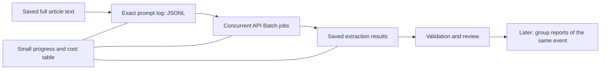

# Extracting events from news articles efficiently

We use the complete saved text of each article to identify whether it primarily
describes one real-world event, then extract that event and its named entities.
Cybercrime and incident-report collections remain separate. No new embeddings
are required for this extraction stage.

The earlier implementation spent substantial time verifying and replaying its
own history. One startup verification took 35 minutes; later, more than ten
minutes passed locally without a new API request. We are replacing those
mechanics with a small workflow that logs exact prompts, saves the results,
and keeps compact progress and spending records. The required model gateway
records submissions in batches, avoiding repeated scans of the old history.
An offline check prepared the exact prompt file for 1,000 staged articles in a
21.4-second operation, with no API calls. This tests preparation, not extraction
speed; live processing remains stopped.

Concurrent API Batch jobs are the preferred bulk route. The previous four-worker
Codex Luna test attempted about 39 articles per minute, which is insufficient for
rapidly completing the remaining large collection. A separate Codex lane could
supplement Batch if a new test shows useful additional speed, but an article must
never be assigned to both lanes.

The existing $150 maximum, full-text prompt, separate collections and previously
processed articles are preserved. Results that fail or are missing remain
unresolved; they are never counted as articles with no relevant event. Extracted
events and entities are provisional until reviewed. Later event dossiers require
reports from at least two different publishers.

For specifically requested research steps, we provide a detailed operating
description and a plain-language explanation like this one. Technical execution
logs are not a substitute for explaining the method and its limitations.

This document describes the redesign and transport choice. It does not claim
that the new executor has already achieved a particular speed or completed the
remaining articles. The [detailed method](LUNA_LEAN_WORKFLOW.md) distinguishes
observed results from planned behavior.
