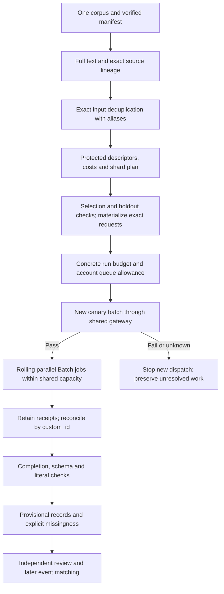

# Full-text Luna multibatch preparation

On 2026-10-17 the user selected full retained article text and asked for the
quickest multibatch process. This fixes the input strategy in the
[v2 event method](LUNA_EVENT_METHOD_V2.md); it does not authorize a new paid
queue. Keep the stopped 12-article extraction lineage stopped. Use the existing
vectors downstream; this workflow creates no embeddings.

## Throughput policy

Use one article per Responses request and several Batch jobs in flight. Keep
incident-reports and cybercrime in separate, manifest-bound requests and files.
Both corpora share the same account/model queue allowance, so a coordinator
must reserve capacity across both. Four local HTTP workers can submit many
remote jobs; four is not a limit on the number of active provider batches.

Exact identical request bodies within one corpus share a proposed call, with
every original row preserved as an alias. This includes identical instructions,
schema, full text, title, metadata availability and model parameters. It does
not merge similar articles, cross corpus boundaries or reuse old model output.
The canonical request follows deterministic archive/line order. A live plan
must register this reuse explicitly and retain the same source-to-result map.

The initial local file targets are 2,500 requests, 64 MiB and two million
input-token proxies, whichever fills first. These are operational choices,
not provider maxima or an empirically optimal shard size. Known account
capacity can instead choose a token target of the lesser of ten million and
available capacity divided by eight jobs and the reservation multiplier.
Smaller files help fill a limited queue and release capacity incrementally;
larger files reduce upload/job overhead. The scheduler can refill as individual
jobs finish, rather than waiting for an entire wave.

The token proxy is the cached `cl100k_base` vocabulary applied to the complete
serialized request body, plus 32 assumed framing tokens. It is **not** Luna's
verified tokenizer. A provisional 1.25 multiplier reserves extra queue space;
this is not a proven upper bound. Actual account limits and other pending work
must be known before dispatch. Missing token estimates never count as zero.
Packets over 32,000 proxy tokens require a separate context/pricing check;
the full text is retained and is never silently shortened.

Candidate model settings are `gpt-6-luna`, reasoning `none`, strict structured
output and a 4,096-token output ceiling. The prompt still asks for small output;
the ceiling avoids forcing every response to be small enough for an arbitrary
low cap. These settings have not been validated on this dataset. Incomplete
responses remain unusable and are not silently retried with a higher cap.

## Provider constraints and speed limits

Official documentation checked on 2026-10-17 describes a 24-hour Batch window,
up to 50,000 requests and 200 MB per input file, and up to 2,000 Batch creations
per hour. Queued input-token capacity is separate from synchronous request
limits and applies across pending jobs for a model. Responses must be joined
by `custom_id`, because output order can differ from input order. The public
model page's queue tiers are planning scenarios, not evidence of this
account's allowance. These limits may change.

Sources: [Batch guide](https://developers.openai.com/api/docs/guides/batch),
[Batch creation](https://developers.openai.com/api/reference/resources/batches/methods/create),
[Luna model](https://developers.openai.com/api/docs/models/gpt-6-luna),
[rate limits](https://developers.openai.com/api/docs/guides/rate-limits).

Concurrent submission does not guarantee an earlier finish. Queue saturation
is a throughput strategy within Batch, not a latency benchmark. A small
separately approved canary batch must pass completion/schema/literal checks
before scaling; it cannot establish semantic accuracy. Requests already in
flight can still complete and incur cost after a later failure stops new work.

## Audited preparation and dispatch boundary

The offline preparer registers methods before scanning, verifies every archive
before and after, retains row-level missingness and retention exclusions,
builds complete packets, and stores exact hash/byte/token descriptors and shard
plans in protected storage. It does not write large upload files yet. A ready
shard is technically packable, not approved for production.

Before submission, materialization must reopen the same verified source bytes,
reconstruct the exact frozen requests, verify all descriptor hashes and retain
the complete JSONL, packets and source maps. Hash-only descriptors are not
sufficient model-attempt evidence. Reconcile the sealed evaluation frame,
existing unknown attempts and concrete selection before making a live plan.

The gateway needs durable upload and submission intents before network sends,
retained provider acknowledgements, polling observations, exact output/error
bytes and per-request results. Unknown upload/job-creation outcomes block
recreation; a timeout does not authorize duplicate work. One writer owns the
audit ledger while bounded network workers handle independent operations.
There are no automatic article retries, accepted dossiers or deletions.

At least two different publishers is the later dossier condition. Publisher
ownership or independent story origin is not an additional eligibility rule;
syndication remains a separate descriptive flag. Article requests and their
costs are technical workloads, not counts of real-world events.

The accepted decision and assistant-reported official-documentation lookup
are retained in protected note
`f924a20b631f9099a2710dc93acc2361412e549a477a104e933194be8de759d6`
under `luna-fulltext-multibatch-design-20261017-v1`. Hosted browsing preceded
that note and was not gateway-audited; the note does not claim retention of
the original raw web result list. Technical-note presentations are unsupported
by `record_presentation` and require an exact protected Markdown artifact.

## Execution status

No v2 paid Batch jobs, model calls or embeddings have been run. The selected
input strategy and software preparation are distinct from execution approval.

Implemented and exercised offline:

- `scripts/luna_multibatch.py`: immutable contract snapshots, complete request
  construction, stable IDs/hashes, streaming shards and fair capacity scheduling.
- `scripts/prepare_luna_multibatch.py`: audited whole-manifest technical
  preparation with all unavailable rows retained and exact protected reports.
- `src/newsresearch/event_multibatch_gateway.py`: **fixture-only prototype**
  extending the shared gateway with asynchronous action/attempt state,
  one writer, bounded network-worker simulation, cross-corpus queue reservations,
  receipt identity checks and result reconciliation. Production is hard disabled.

The prototype has no live HTTP transport. An audited materializer, reconciled
eligibility/holdout selection, staggered polling, creation-rate control and
explicit unknown-receipt recovery still need integration. It currently
revalidates the whole plan in each phase; that must be made efficient within
an audited session before a corpus-scale service. Neither its tests nor the
offline shard plan establish production throughput. A canary approval cannot
substitute for these missing components.

The dedicated preparation/input/contract suites passed 162 synthetic checks;
the gateway prototype passed 22. Ruff passed across source, tests and scripts;
mypy passed for 127 source modules and the two new preparation helpers. These
are software checks, not model-quality or event-count findings.

Cybercrime preparation completed in its dedicated owner:

- Result `c91132f38369d77d2374879d52f5409e9176bf67138d03cae53f168210f7385b`.
- Manifest `d48dd5947f0aa5f84462feceec08f49c86d15a5778450bf1aeb5260a292c2818`.
- Shard plan `0baf333da907b9854a9a741bbb22950f63a3dec4885bb9d53e7e6ccaef7c3f84`.
- Exact protected overview
  `4e9c7c91e032ef239ccbb40b1800483036949cc0d78ca768d2b4b262cc9e90ec`.

It scanned all 61,089 rows in eight verified archives: 60,838 usable full bodies,
60,836 unique exact-input requests, two aliases, and 251 retention-unavailable
rows. There were no missing bodies, malformed rows, failed/pending archives or
oversized/manual-context requests. The 155 planned files contain 309,045,448
input-token proxies and 1,433,731,401 prospective JSONL bytes. The 800-output
scenario is USD27.62; reserving 4,096 output tokens each gives USD77.75. These
are conditional estimates, not billed usage or a confirmed budget ceiling.
