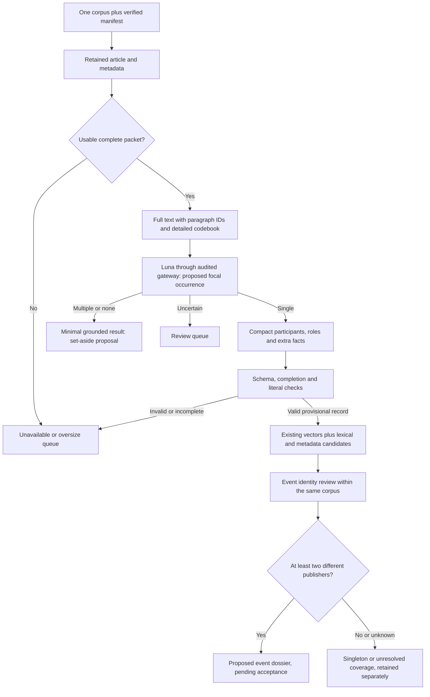

> Documentation snapshot, 23 October 2026. [Original path](../../../../docs/LUNA_EVENT_METHOD_V2.md); [current study/infrastructure overview](../../README.md). Historical status and launch instructions below are preserved as evidence, not authorization. Relative links were relocated; no research was replayed.

# Full retained text and compact event extraction — v2

This is the current extraction contract, replacing the entity/input
recommendations in [the v1 excerpt method](LUNA_EXCERPT_METHOD.md). The original
prompt, schema, workload measurements and stopped pilot remain unchanged.
Implemented components are a pure input builder, prompt, strict JSON Schema,
literal/reference validator and synthetic tests. No v2 inference, paid API
batch, article exclusion, grouping, model accuracy measurement or re-embedding
has occurred. On 2026-10-17 the user accepted this contract and selected full
retained input text. The [multibatch preparation](../../../../docs/LUNA_MULTIBATCH.md) adds exact
request identities, within-corpus exact-input reuse and capacity-aware shard
planning. A production Batch gateway remains a separate integration; choosing
full text is not paid-run authorization.

## Evidence used to revise the design

Two separate audited, model-free source inspections returned complete retained
text, rather than rejected prior extraction outputs:

| Inspection frame | Coverage | Limits |
| --- | --- | --- |
| Existing frozen development selection | 12/12 articles, 253 passages, 38,797 body characters; zero missing/failed/pending inspection slots | The original development selection is not a representative sample. This inspection binds the original plan/owner, but does not newly resolve its sources against the later corpus manifests. Do not present it as a new incident-reports corpus sample. |
| Cybercrime manifest, one minimum seeded row-hash per archive | 8/8 distinct articles, 38 passages, no selected title/body collisions; zero failed/pending archives | Selection considered 61,089 saved rows: 60,838 usable and 251 explicitly retention-excluded. One per archive gives unequal article inclusion probabilities and is for design exploration, not population prevalence. |

The inspections establish available source evidence, not entity frequencies,
accepted focus labels, gold event identities or a claim that malware is rare.
They exposed design cases involving financial announcements, products, court
decisions, warnings, reports, physical incidents, commentaries and roundups.
Retained-body contamination by related-story cards and a title/body mismatch
also need explicit handling. Concrete source-linked examples are retained in
the protected reports and shown in the private chat; source bodies are not
copied into this repository.

Protected inspection notes:

- Original owner `luna-seven-day-validation-20261016-v1`, note
  `58d95bf1b7d390d250010b7f2ce120577ff1be0a135facfe5e6b4650ba86278d`;
  full report `c3faf4ff2364038d7bba7d8ae2caf89a13f0e52cb4e0b7ce030cde52863b4c72`.
  Compact replay of articles 3–8:
  `3ffbe52462c5d8bdef317e80f02c177352033941fd512562189361c65c7952cf`.
- Separate owner `entity-design-cybercrime-20261017-v1`, note
  `f3f343ae28df46f0a2f2d3195ae9b6817c386f3bc4c3fe5391c0f2de6ed89072`;
  report `289a07aa3e84db2f69158832e764c403cc42703c5819ac40e9a395a707e2b00a`.

`record_presentation` does not support these inspection-note kinds. Their
exact overviews were saved as protected artifacts; UI delivery is unobserved.
No source classification or population estimate is inferred from inspection
coverage. Native design discussion is not an audited model extraction.

## What established NLP libraries contribute

Official documentation and model metadata were fetched on 2026-10-17 through
a separately registered `Research.execute()` operation: six documentation
pages and two supplemental model metadata files, all retrieved; zero HTTP
failures/pending requests and no models run. The initial metadata registration
was rejected for a credential-like field name before any fetch; the corrected
registration and that failed attempt are preserved. Two spaCy documentation
pages lacked dynamically loaded label details, so the supplement reads the
explicit 3.8.0 model metadata. This does not assert that 3.8.0 is the latest.

| Library/model reference | Documented categories | Consequence for this method |
| --- | --- | --- |
| spaCy English and Dutch small model metadata, version 3.8.0 | Both specify 18 categories, including PERSON, ORG, GPE/LOC/FAC, PRODUCT, LAW, WORK_OF_ART, EVENT, dates and numerical expressions | Useful starting vocabulary; separate names from time/measurement attributes. A predicted EVENT span is not an event dossier. |
| Stanford Stanza | Dutch CoNLL02/WikiNER models use four categories; English models offer four-category CoNLL03 or 18-category OntoNotes schemes | Labels depend on language and training corpus. Do not assume equivalent coverage from a library name. |
| Hugging Face Transformers tutorial, WNUT17 | person, location, corporation, group, product, creative-work, with token-boundary labels | Useful support for groups/products/content; Transformers does not prescribe a single universal ontology. |
| spaCy EntityRecognizer and EntityRuler | Non-overlapping named spans; optional token/phrase rules | Candidate mention detection and explicit alias rules are possible aids, not proofs of event focus, participation or identity. |

Sources: [spaCy English metadata](https://raw.githubusercontent.com/explosion/spacy-models/master/meta/en_core_web_sm-3.8.0.json),
[spaCy Dutch metadata](https://raw.githubusercontent.com/explosion/spacy-models/master/meta/nl_core_news_sm-3.8.0.json),
[Stanza categories](https://stanfordnlp.github.io/stanza/ner_models.html),
[Hugging Face token classification](https://huggingface.co/docs/transformers/tasks/token_classification),
[spaCy recognizer](https://spacy.io/api/entityrecognizer),
[spaCy rules](https://spacy.io/api/entityruler).

Protected documentation notes in `entity-design-library-docs-20261017-v1`:
`df901909ca1ada9c6e2791b613f5743abc250db973a2c954cff42fd24f24f35c` and
`143c757724db83d4ccbed01d2e71019aeb9bf6bfb2dd32322931ecf229e757b7`.
Retained source bytes and request metadata do not capture hosted browsing or
native conversational reasoning as gateway inference.

No library was benchmarked on this dataset. Published benchmark scores do not
establish local performance or make one taxonomy empirically best. Optional
future local NER must also run through an audited adapter with pinned model
versions. Its missing mentions must never be a hard article-exclusion rule.

## Event-relevant entity vocabulary

The output contains **participants**, a broader concept than proper-name NER.
Each has a `kind`, exact `surface`, `named` flag and separately evidenced roles.
An unnamed affected group or physical object can be useful without becoming a
globally identified named entity. No kind is mandatory in every article.

| Kind | Include when important to this event | Avoid |
| --- | --- | --- |
| organization | Companies, public institutions, regulators, courts, police, universities, nonprofits | Listing every employer, publisher or comparison company |
| person | Actors, affected people, decision-makers and material claim sources | Every quoted expert or historical person |
| group | Affected communities, customers, workers or collectives, named or explicitly described | Invented names; treating a descriptive group as globally identical across articles |
| place | Relevant country/city/site/facility/route or other location phrase | Inferring event location from headquarters, nationality or residence |
| product | Named or described software, AI models, platforms, services, tools or devices | Promoting a product's brand into the corporate actor; requiring a malware field |
| artifact | Reports, legal instruments/cases, datasets, books, videos and central named initiatives/projects | Treating all mentioned documents or conference names as organisations |
| object | Specific physical infrastructure, vehicles, accounts, assets or other essential objects | Generic filler such as an invented “AI system” |

Roles are `initiator`, `operator`, `developer`, `affected`, `authority`,
`claim_source`, `event_place`, and `subject`. Multiple supported roles are
allowed. A court is an organization by type; adjudicating is a role. A named
criminal collective can be a group acting as initiator; “threat actor” is not
a universal entity type. A software name may identify malware when the text
actually says so, without creating a required malware slot.

Dates/times, amounts, counts, techniques, identifiers, fiscal periods and named
occurrences are attributes, not an obligatory list of entities. Preserve them
as literal values where useful. The focal action plus participants and these
discriminators support later matching; sharing an organization or product does
not establish a shared event.

## Detailed input, selective output

1. **Stable instructions and codebook:** define the event unit, focal/background
   distinction, source boundaries, types versus roles, factual qualifications,
   output priorities and abstention rules. Keep this prefix versioned.
2. **Metadata context:** title, language, publisher and publication fields.
   Missing values remain null. Publication time is not occurrence time. Provider
   concepts/categories are not authoritative labels and are not included in the
   initial builder's evidence. Keep corpus/manifest identity, original tags,
   source hashes, URLs and attempt provenance in the application envelope.
3. **Full retained text:** title `t0`; exact ordered body paragraphs `p1…`.
   Every body character is preserved, including separators. The source map
   retains hashes and Unicode offsets locally; Luna does not repeat it.
   No silent shortening, paragraph reflow or boilerplate deletion occurs.

If a packet exceeds the selected model/context ceiling, put it in an explicit
oversize route; do not silently classify a cropped version as full text. The
pure builder does not enforce provider context limits or prove publisher-page
completeness. Production callers still must bind corpus/source identities and
retention, persist packets, and use the shared gateway.

The focus labels are `single`, `multiple`, `none`, `uncertain`. The v2 `none`
corresponds conceptually to v1 `no_event`; old rows are not silently rewritten.
Only `single` receives an event record. Other outcomes return a reason code,
supporting refs, any proposed boundary exclusions, and `event: null`.

For a single event, return:

- A short event summary, literal action and optional literal occurrence time.
- Source status and its evidence: reported/alleged/planned/unclear. These are
  source presentations, not verified truth or confidence probabilities.
- Event-essential participants with literal surfaces and separate role refs.
- A few explicitly mentioned extra facts, with free short predicates, literal
  values, subject and attribution IDs when supported, evidence refs and their
  own stated/alleged/denied/planned/unclear status. `value.refs` grounds the
  literal; separate `support_refs` can ground qualifications and attribution
  appearing elsewhere in the article.

Do not force every mention into output. Usually aim for 2–6 participants and
0–3 extra facts, with provisional ceilings of 12 and six. The empty case is
valid when the text supports no such detail. Overflow flags preserve omitted
details caused by caps and trigger a later review route rather than declaring
the record exhaustive. These caps are design choices to evaluate, not measured
coverage guarantees. No compulsory canonical names, aliases, normalized dates,
long quotations, inferred values, confidence scores or repeated fixed metadata.

Literal values and refs replace repeated quote blocks. The application finds
exact offsets in the retained evidence; repeated matches remain explicit,
rather than arbitrarily selecting the first. Normalization can be a separate,
versioned downstream operation. Literal validation cannot prove semantic roles,
negation, source truth or correct event boundaries.

## Rules prompted by actual source inspection

- Historical incidents, trials and precedents do not automatically make a
  report about one new judgment a roundup. Preserve the new judgment as the
  candidate focal event and keep its underlying history distinct.
- One warning or report can discuss multiple underlying cases. Qualify the
  warning/report as an occurrence when it is the focal news; do not convert all
  its examples into one underlying incident.
- Distinct coequal developments in an actual roundup produce `multiple`.
  Boilerplate and unrelated recommendation cards require separately evidenced
  boundary proposals; they do not alone imply a multi-event article.
- If a paragraph mixes content with suspected residue and the boundary changes
  the decision, use `uncertain`. Do not discard the entire paragraph.
- A title about an incident plus a generic company-profile body yields an
  insufficient-body route. Richer input cannot repair an incomplete source.
- Preserve negation and attribution per fact: reporting an intrusion does not
  make a denied customer-data leak an affirmative finding.
- Opinion is a genre, not an automatic failure of single-event focus. Collection
  membership also does not establish topical relevance or incident eligibility.

## Tradeoffs and evaluation

| Choice | Benefit | Cost or failure mode to evaluate |
| --- | --- | --- |
| Full retained text | Supplies middle-body distinctions, qualifications and useful identifiers | More input; more unrelated mentions and collection residue require careful focus rules |
| Seven general participant kinds plus roles | Applies across technical, business, legal and physical events | Domain-specific distinctions may need extra facts or later enrichment |
| Event-essential mentions only | Smaller outputs and fewer misleading entity-overlap matches | Omitted aliases/secondary participants can reduce matching recall |
| Literal surfaces, local offsets | Avoids v1 normalization-versus-exact-span failures and repeated quotes | Cross-language aliases and relative-date resolution remain downstream work |
| Minimal non-single output | Reduces extraction cost for proposed exclusions | Rejected articles are harder to re-use without another pass; source evidence remains available |
| Explicit uncertainty and overflow | Prevents missing information becoming a false negative | Creates a review queue; its size and handling need measurement |

The earlier all-row audit remains historical v1 workload evidence: 144,982
usable incident-reports rows and 60,838 usable cybercrime rows. Its full-body
input premium over 300+300-word inputs was approximately USD3.06 across the two
separate corpora at the frozen Batch input rate and fixed output assumption.
Those are raw saved-row workloads, not unique events. The later accepted
full-input [multibatch preparation](../../../../docs/LUNA_MULTIBATCH.md#execution-status) measures
the v2 serialized prompt/schema/paragraph inputs for both complete manifests.
At an assumed 800 output tokens per request its separate-corpus estimates sum
to USD95.20; reserving the full 4,096-token output allowance gives USD264.80.
Actual output lengths and Luna tokenization remain unmeasured. Do not use the
historical v1 totals as v2 estimates or treat these scenarios as strict billing
caps. A practical run still needs a concrete selection, conservative reservation
and usage reconciliation.

Before deployment, freeze a new partition-bound plan and assess new canaries
followed by an explicitly authorized bounded study. Do not resume the stopped
12-article extraction. A Batch submission needs an implemented gateway lifecycle
that preserves task identities, exact requests and all completed/failed/unknown
outcomes; a failed canary batch must block later batches, without assuming it
can retract requests already executing in that batch.

Use independently reviewed, held-out sources distinct from these design
examples. Evaluate focus/false-exclusion rates, entity mention and role accuracy,
important-discriminator recall, boundary mistakes, denial/attribution fidelity,
overflow and end-to-end candidate recall separately by corpus/language. Count
uncertain/unavailable/invalid cases in coverage, not as negatives. Do not claim
that a small canary establishes a low false-exclusion rate. Classifier validity
and downstream dossier validity are different estimands.

The lower matching/review stages are a proposed continuation, not executed by
the extraction helpers. Different publishers must be verified separately from
different URLs; copied/syndicated text is not automatically independent
corroboration. Failure to find a partner in a small candidate list does not
prove an article is a true singleton.

## Implementation

- `scripts/structured_article_input.py`: exact full-text packets, source maps
  and literal resolver; pure helper, not a research entry point.
- `scripts/luna_event_contract_v2.py`, `prompts/luna_event_v2.txt`,
  `schemas/luna_event_v2.json`: revised contract, builder and validator.
- `examples/luna_event_output_v2.synthetic.json`: fictional software fixture only.
- `scripts/inspect_entity_design.py`, `scripts/inspect_cyber_entity_design.py`:
  audited evidence inspection, without classification.
- `scripts/inspect_ner_documentation.py`: bounded official-reference retrieval.

Production use still requires source/corpus bindings, context/token checks,
exact frozen packets, provider-compatible schema validation, Batch dispatch and
reconciliation, concrete paid-run authorization and independent evaluation.

Validation: 136 focused synthetic tests passed; Ruff and mypy passed for all
five new source helpers. This establishes software behavior only. The fictional
three-participant/one-fact example serializes to 1,051 UTF-8 bytes; a fictional
minimal multiple-event response uses 130 bytes. These are illustrative JSON
sizes, not model-token measurements, expected dataset output lengths or bills.
