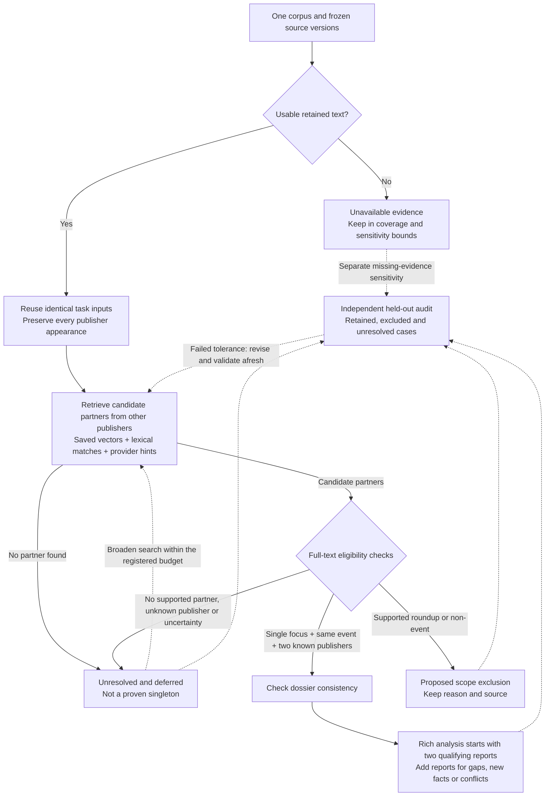

> Documentation snapshot, 23 October 2026. [Original path](../../../../docs/SCOPE_REDUCTION_METHOD.md); [current study/infrastructure overview](../../README.md). Historical status and launch instructions below are preserved as evidence, not authorization. Relative links were relocated; no research was replayed.

# Single-focus, multi-publisher event scope

Date: 2026-10-17. User-selected target: reports whose primary subject is one
real-world event, excluding reviews/roundups of several coequal events, and only
events represented by **at least two different publishers**. Cybercrime and
incident-report collections stay separate. The user selected different publishers
explicitly; two reports or updates from one publisher do not satisfy this gate.

This document proposes a reversible screening and recall method. It does not
accept memberships, delete sources, dispatch models or establish a validated
recall rate. The executed metadata audit recorded below measures
available stored fields and provider hints, not semantic eligibility.

## Operational definition and decision diagram

Define the method as **staged event selection with a recall audit**. Its objective
is to minimize expensive full-article extraction while keeping the loss of
qualifying events within an explicitly chosen, independently evaluated limit.
The counting unit is an event dossier. Article processing volume, report omission,
event retention and the completeness of extracted information are separate
outcomes. The [completed reduction experiments](SCOPE_REDUCTION_EXPERIMENTS.md)
support the design choices below; the complete semantic pipeline is not yet
validated or deployed.

An event qualifies when at least two retained reports:

1. belong to the same bound corpus;
2. each primarily describe one focal occurrence, with background context allowed;
3. are supported as describing that same occurrence, rather than a related topic;
4. come from two known, different publishers under a versioned identity mapping.

Additional reports must be checked for dossier consistency. A-B and B-C matches
do not automatically justify an A-B-C merge. Two publishers carrying syndicated
text satisfy the publisher-count component, but the shared reporting origin
remains flagged; independent authorship/ownership is not silently required.

Run the following pipeline independently for incident reports and cybercrime:

Solid arrows describe processing; dashed arrows describe expansion or evaluation.
Passing an audit permits the frozen selection policy to be used within its
evaluated scope; it does not turn missing outcomes into negatives or automatically
accept every dossier. Review acceptance still requires the registered evidence
and reviewer or automatic-policy conditions.

| Stage | Work avoided or postponed | Tradeoff and required control |
| --- | --- | --- |
| Separate corpora and preserve provenance | Avoid irrelevant cross-corpus comparisons | Some reporting may exist in the other corpus; conclusions concern the selected partition only. Never combine silently. |
| Exact task-input reuse | Avoid repeated screening of identical title/body/language | Measured potential focus-input reductions are about 0.8% for incident reports and 6.2% for cybercrime. A focus label cannot substitute for date-sensitive extraction, publisher verification or event membership. Bind the future model, prompt, schema and corpus cache versions. |
| Hybrid different-publisher retrieval | Avoid all-pairs comparison and same-publisher eligibility checks | Similarity/provider IDs generate candidates, not truth. Filter known same-publisher candidates before ranking, refill the shortlist, and retain lexical/metadata routes for missing vectors. Missing IDs and a long publication gap are not exclusion rules. |
| Compact full-text focus and partner screen | Avoid rich extraction of roundups, non-events and unsupported candidate pairs | The short output is cheap, but complete retained input is still needed. Preserve exact supporting spans and uncertainty. One primary event may include several background events. False-negative screening requires independent evaluation. |
| Two qualifying reports first | Postpone rich reading of additional reports | This meets a minimum publisher gate, not full evidence completeness. Preserve all links; expand for gaps, corrections, new facts, contradictions and identity ambiguity. Audit missed information separately from missed events. |
| Reversible set-aside queues | Keep uncertain or low-priority material out of the current rich-analysis queue | Deferral is not proven total savings. Retain reasons, versions, missingness and revisit triggers. Excluded material can remain discovery evidence without counting as an eligible report. |
| Independent omission and dossier audit | Makes controlled scope reduction assessable | Review itself costs work. Sample retained and every set-aside stratum with recorded probabilities; unresolved references remain possible errors. Report absolute loss bounds as well as percentages, and evaluate event retention separately. |

### Outcomes and missingness

Maintain four operational outcomes: **eligible event dossier**, **supported scope
exclusion**, **unmatched/uncertain**, and **evidence unavailable**. Until the
semantic screen and its acceptance policy pass evaluation, exclusion labels are
proposals. The user-selected two-publisher criterion does not make a failed
partner search sufficient proof of ineligibility.

Missing categories, concepts or vectors require another candidate route; they
are missing predictors. Missing publisher identity prevents a positive
two-publisher decision until resolved. Missing bodies or retention exclusions
prevent substantive assessment and remain in coverage/sensitivity totals.
Failed model processing is a missing outcome, not a non-event label.

The primary evaluated population must be named: usable saved-text evidence in
one corpus. Results cannot be generalized automatically to unavailable evidence
or all real-world events. For the full archive, bound unavailable eligibility
without assuming random missingness. One missing report may be the only second
publisher, so an article-missingness percentage cannot bound event loss.

### Parameters and acceptance

Before evaluation, freeze the source frame, publisher mapping, focus rubric,
event boundary, candidate routes and expansion budgets, cache contracts,
additional-reading triggers, evaluation frame and acceptable loss tolerances.
There is currently no validated universal similarity cutoff, date window or
top-k choice for this task. A seven-day limit, provider-ID requirements and
original-top-one truncation lost prior cross-publisher model proposals in the
completed diagnostic and are not adopted as safe knockouts.

Assess separately: focus-screen errors, recovery of a different-publisher
partner, event retention with at least two publishers, dossier contamination/
fragmentation, and information lost by reading only two reports initially.
Use an independently reviewed event reference frame or defensible multiplicity
accounting for event-level claims. Report- or archive-row-weighted audit results
are not event recall.

Choose a loss tolerance explicitly; 1%, 2% and 5% are comparison scenarios, not
adopted or achieved targets. Use a predeclared final evaluation or a properly
designed sequential alternative. Revise failed methods using development data
and validate afresh; do not repeatedly tune on the same held-out answers.
The prepared 420 archive-row anchors are unreviewed feasibility draws, not a
passed audit of this complete policy. This definition and diagram introduce no
new corpus processing, model run, membership change or execution permission.

## What single-focus means

One primary occurrence can have several participants, dates, claims, consequences
and quotations, plus explanatory history. Do not count every action verb, entity,
sentence-level event label or extracted claim as a separate focal event.
The gate is the article's focus, not the number of event mentions anywhere in it.

Use `single_focus_event`, `multiple_event_roundup`, `non_event`, and `uncertain`.
Keep missing text, partial coverage and technical failures separate from these
semantic labels. A compact event sketch and exact evidence should accompany a
single-focus decision. A plan announcement is itself an occurrence, even if the
announced action is future; a generic forecast is not automatically one.
Product reviews, historical roundups and general trend pieces need their own
clear boundary examples. Words such as "review", "latest" or "live" are screening
cues, not reliable knockout rules.

Read the complete retained body when making a final focus determination. A
title/lead/headings pass can prioritize cheap review, but can miss later roundup
sections and must not silently claim whole-article coverage. Register any
validated automatic screen separately. The failed earlier extraction contract
is not reused as a valid focus classifier, and its stopped plan stays stopped.

## What the provider exposes

Current primary references: [official filters](https://newsapi.ai/blog/newsapi-sandbox-filters/amp/),
[article query SDK](https://github.com/EventRegistry/event-registry-python/blob/master/eventregistry/QueryArticles.py),
[return information SDK](https://github.com/EventRegistry/event-registry-python/blob/master/eventregistry/ReturnInfo.py),
[event query SDK](https://github.com/EventRegistry/event-registry-python/blob/master/eventregistry/QueryEvents.py),
and [official examples](https://newsapi.ai/intro-python).

| Field/filter | Useful role | Restriction |
| --- | --- | --- |
| Article `dataType` (`news`, `blog`, `pr`), distinct from `source.dataType` | Optional source/content class scope | Not an article genre or single-event guarantee. Blogs/PR can contain concrete primary reporting. |
| `categories`; `categoryUri`, `ignoreCategoryUri` | Subject-topic screening | Business/technology/crime labels do not identify a roundup or establish event identity. Missing tags stay unknown. |
| `eventUri`; `eventFilter` | Cheap same-provider-cluster candidate channel | Missing does not mean singleton. Populated does not mean one focal event, correct clustering or two eligible publishers in the saved corpus. |
| `isDuplicate`, `originalArticle`, optional `duplicateList` | Reuse processing; track syndication and source appearances | Provider duplicate status is not a measured independent-reporting assessment. |
| `concepts` URI/type/score | Retrieve organizations, people, locations, systems and distinctive references | Shared concepts are not same-event proof; number of concepts is not number of focal events. |
| `lang`, dates, locations, source metadata | Explicit scope and candidate prioritization | Publisher location differs from event location; publication dates differ from occurrence dates. |
| `sim`, `wgt`, query relevance, sentiment, shares | Auxiliary diagnostics/ranking where defined | None is a calibrated single-event or singleton probability. Do not use as default exclusions. |

The SDK's `eventFilter` options are `skipArticlesWithoutEvent`,
`keepOnlyArticlesWithoutEvent`, and `keepAll`. The first can prioritize provider
clusters but is not a safe recall-preserving knockout. Duplicate filters include
`isDuplicateFilter=skipDuplicates` and `hasDuplicateFilter=keepOnlyHasDuplicates`;
the latter indicates copied material, not independent corroboration.

`minArticlesInEvent=2` is an event-query parameter; the documented count is
regardless of language. Event results can expose `totalArticleCount`, with
`EventInfoFlags(articleCounts=True)` requesting counts. This describes the
provider's wider event cluster, not two eligible publishers in our saved,
partitioned collection. Recount qualifying publisher identities locally.

[Signal Types](https://newsapi.ai/signal-types) now advertises sentence-level
event classes and Fact/Opinion/Forecast factuality. The
[October 2026 update](https://eventregistry.org/blog/event-registry-newsapi-ai-product-updates-2026/)
describes Event Type extraction in the article-processing backend. These are
not whole-article focus/genre labels and are not independent truth checks.
The [mention SDK](https://github.com/EventRegistry/event-registry-python/blob/master/eventregistry/QueryMentions.py)
documents `eventTypeUri`, `ignoreEventTypeUri`, `showDuplicates`, `minSentenceIndex`
and `maxSentenceIndex`. The inspected SDK did not expose a facticity/factuality
query parameter; do not invent one or assume new annotations were saved in older
archives. Inspect actual availability before proposing a paid metadata refresh.

## Proposed cheap sequence

1. **Partition and retain.** Bind exactly one corpus manifest/hash. Preserve all
   original rows, versions and retrieval history. Resolve article/publisher
   aliases conservatively with an auditable mapping. A missing publisher is
   unresolved, not a reason to assert single-publisher status.
2. **Deduplicate computation.** Process identical text once where method and
   publication-dependent context permit, retaining every publisher appearance.
   Track source versions, publication items and duplicate families separately.
3. **Retrieve before rich extraction.** Union equal provider-event IDs, available
   saved article/passage vectors, lexical/entity/identifier matches and duplicate
   relationships. Prioritize a different publisher but retain a broad route
   across the full allowed partition. Filter corpus before top-k. Do not impose
   a universal seven-day cutoff or treat missing vectors as negative results.
4. **Screen candidate articles cheaply.** Combine focus classification with a
   short event sketch and grounded evidence, rather than a large multi-event
   schema. Use complete retained text or record explicit uncertainty/coverage.
   Provider categories and title cues help prioritize; they do not silently
   override an uncertain semantic gate.
5. **Confirm a qualifying partner.** An eligible focal report needs one
   supported same-event report from another publisher. Stop partner checking
   once this eligibility is established; that saves gate cost, not all later
   dossier assembly checks. Two related-topic reports are insufficient.
6. **Richly extract retained candidates only.** Store proposed dossiers with
   source-specific spans and consistency checks. Recompute the two-publisher
   requirement after all focus/scope exclusions; a second publisher's roundup
   alone does not qualify. Related follow-up events remain separate.
7. **Set aside reversibly.** Use `unmatched_after_retrieval_vX`, `roundup`,
   `non_event`, `out_of_scope`, `unavailable`, or `uncertain`, with reasons and
   method versions. Never relabel an unmatched case as a proven singleton.
   Retain excluded material as a discovery index and review evidence, without
   counting it as an eligible dossier contribution. Reconsider unmatched records
   after new sources, index changes or improved matching.

The literal gate is two publishers, not two independent reporting origins or
ownership groups. Syndicated text appearing at two publishers can meet the
publisher-count part; flag it explicitly and report an additional independent-
reporting diagnostic if ascertainable. Requiring independent reporting is a
separate, stricter policy and must not be introduced silently.

Current seven-day groups remain historical working groups; this prospective
eligibility method does not adopt new memberships or resume shelved cutoff work.
The last completed published full-corpus snapshot has only 19,576 compatible
article vectors. Later embedding authorization is not a completion receipt;
reconcile current execution/index status before choosing a full-corpus route.
Provide lexical/metadata retrieval for uncovered versions instead of excluding
them. Numerical nearest-neighbor recall is not event-partner recall.

## Recall protection

Freeze the candidate union, shortlist/expansion budgets, focus rubric and partner
decision before held-out validation, separately per corpus. No finite search
proves global uniqueness; the inference is restricted to the saved source frame.
Keep failed and unresolved checks outside the negative class.

Probability-sample retained cases and every excluded stratum: apparent unmatched
with/without vectors, missing event IDs, roundup/non-event decisions, long-gap
reporting, language minorities and unknown publishers. Use full-text review and
a broader independent partner search, including outside the production shortlist.
Record inclusion probabilities, weights, eligible frame, missingness and review
identity. Oversampling risky exclusions helps only if weighted appropriately.
These diagnostic strata overlap: use disjoint sampling strata or retain exact
combined inclusion probabilities rather than counting an article several times.
Keep event families/syndicated copies separated between tuning and validation.

Report these distinct quantities with uncertainty:

- Focus-screen recall for eligible single-focus reports.
- Retrieval recall for finding at least one qualifying different-publisher
  partner, not arbitrary same-topic or same-publisher neighbors.
- False-omission rate among the set-aside cases.
- Event-retention recall: qualifying events still represented by at least two
  different publishers after the full pipeline.
- Later dossier contamination, fragmentation and unresolved coverage.

Article-anchor sampling alone is not event-level recall: heavily covered events
have more chances to enter the sample. Include a separately defined event-level
frame or account for multiplicity before making event-population claims. Do not
tune the screen against its held-out answers, infer recall from agreement between
two correlated retrieval methods, or claim a target from a small zero-error sample.

Existing singleton work motivates this caution. The expanded-context study
reported **19 raw model-proposed matches, 21 uncertain, 59 unmatched among the
same top three, and one incomplete** among 100 original anchors. One positive
rationale also had a contrary-phrase diagnostic. These are neither confirmed
rescues nor established true singletons. See
[the preserved follow-up](../../../../docs/SINGLETON_CONTEXT_FOLLOWUP.md). No new judgments from
that exhausted queue are authorized by this design. Those historical judgments
did not evaluate this new single-focus plus different-publisher gate, so they
cannot estimate eligible-event retention under the new scope.

## Additional scope controls

| Proposed criterion | Disposition | Recall/interpretation tradeoff |
| --- | --- | --- |
| Exact duplicate payloads/redundant versions | Reuse computation; retain provenance | Low-risk cost saving when temporal context and versions match; not an article deletion. |
| Empty, corrupt or unavailable text | Separate unavailable queue | Cannot classify semantically; keep in coverage denominator. |
| Clear roundups, tutorials, broad reviews, non-event commentary | Set aside after validated focus screening | Matches requested scope; uncertain cases need review. |
| AI or cybercrime is incidental to the primary event | Optional topic knockdown using grounded evidence plus tags | Requires a corpus-specific substantive-relevance rule; category absence alone is insufficient. |
| Generic forecasts, abstract risks and evergreen advice with no identifiable occurrence | Proposed non-event screen | An announcement, forecast release or concrete decision can itself be an event; define boundaries first. |
| Prespecified event periods, languages or event geography | Explicit optional scope restriction | Changes the research population; Dutch publisher/language alone does not mean a Netherlands event. |
| Press releases/blogs/sponsored material | Optional separate queue | May remove primary accounts; not adopted by the single-focus rule alone. |
| Limited representative reports per already eligible dossier | Potential later-analysis saving | Preserve all linked reports; retain different publishers, new evidence, corrections and conflicts. It does not remove the need to establish membership. |
| Low sentiment/social shares/source rank, short text, missing tags, absent eventUri or low cosine | Avoid as automatic knockdowns | Biased or weak proxies; can discard valid less-prominent events. |

The high-impact ordering is cheap retrieval and a compact focus/partner gate
**before** rich extraction, followed by representative evidence for later analysis.
Cost becomes local preparation + screening + partner checks + extraction of
retained reports + reconciliation + recall evaluation. Halving rich-extraction
volume roughly halves only that component when lengths are comparable; total
savings are smaller because screening/review adds work. Actual retained fractions
and token savings are unmeasured until the new method is evaluated. Provider
metadata counts below must not be used as the retained semantic workload.

## Executed saved-metadata availability audit

Both separate offline runs completed through `Research.execute()` with actor
`codex:article-scope-metadata-audit`, method
`partitioned-article-scope-metadata-v1`, and dedicated protected owner
`%LOCALAPPDATA%/AI-In-the-News/article-scope-metadata-audit-20261017-v1`.
Protocol, question, selection, dossier definition and exploratory profile were
registered before archive scanning. Each run bound its own corpus manifest,
reconciled its original inventories, checked archive hashes before and after
streaming, and reconciled all declared row counts.

| Saved metadata / coverage | Incident reports | Cybercrime |
| --- | ---: | ---: |
| Scanned archives | 11 | 8 |
| Scanned article rows | 148,025 | 61,089 |
| Nonblank saved body strings | 147,580 | 60,838 |
| Missing/blank/nontext bodies | 445 | 251 |
| Populated categories | 146,715 | 0 |
| Populated concepts | 146,770 | 0 |
| Nonblank provider event IDs | 70,785 | 11,295 |
| Missing/null/empty/non-string provider event IDs | 77,240 | 49,794 |
| Populated source URIs | 147,405 | 60,838 |
| Rows marked `isDuplicate=true` | 6,450 | 9,646 |
| Recorded `dataType=news` | 147,341 | 60,838 |
| Missing `dataType` | 684 | 251 |
| English / Dutch / missing language | 143,237 / 4,552 / 236 | 0 / 61,089 / 0 |

Incident-report categories are empty for 60 rows and absent for 1,250;
concepts are empty for five and absent for 1,250. Cybercrime categories and
concepts are absent in every row. No rows in either corpus contain any of the
checked `articleType`, `type`, `genre`, `eventTypeUri`, `eventTypes`, `mentions`,
`signals`, `facticity`, or `factuality` fields. These candidate field names are
availability probes, not a claim that the provider promises all these keys.
All populated content types are `news`; a news/blog/PR filter therefore cannot
reduce the known-type saved workload. Missing type remains unknown.

Within incident reports, 18,305 distinct provider event IDs are observed. Of
these, 8,436 contain at least two observed article identities and two exact
source URIs, covering 60,632 rows. Cybercrime has 2,846 distinct event IDs, of
which 1,526 meet that metadata-only condition, covering 9,891 rows. Another
10,153 incident-report and 1,404 cybercrime event-ID rows have only one observed
source URI. No event-ID rows lack a source URI. **None of these counts establishes
single-focus reporting, normalized publisher identity, same-event correctness,
eligible dossiers, retained workload, or true singletons.**

Provider article IDs are distinct across all rows within each separate corpus;
none has conflicting nonblank event IDs or source URIs. Conservative canonical
URLs number 148,025 and 60,674 respectively. Neither result measures text-copy
families, publisher aliases, independent reporting, or cross-corpus overlap.

These are archive-row metadata counts, before protected catalog deduplication
and quarantine. The audit did not re-run protected retention screening. Do not
equate nonblank source bodies here with the historical 205,105 usable retained
text versions. Raw article content, names, tag labels and identifiers were not
retained in these reports. There were zero failed/pending archives, model calls,
new embeddings, retrieval queries, classification/exclusion decisions, or
membership changes in either run. No relevance cutoff or yes/no eligibility
totals apply. Recall and actual cost reduction remain unmeasured.

Protected references:

| Corpus | Note ID | Exact aggregate Markdown artifact | Manifest SHA-256 |
| --- | --- | --- | --- |
| incident-reports | `e67bf52c5f59e79a0e1410f83b37ebebbbf70dbdd83dbf5b2861be05c4380bf3` | `951f46cc61f1d9431589119f71319f2dffe16e2c1cbf21a3657576c26191a6b0` | `7e5f5896014d706e39a453f6c179a31e3394a57bd65a4a85ba5a5b7eae74fc9f` |
| cybercrime | `695025fc5dbffff6fd54642576291162c6cdf510f58d65d5e049c4bc5b37257a` | `59116ecd84553dc5724a43ac758f707e48776fdab2b6b32c7aacf68ce43c8ec8` | `55474fcd0060286ebbd32568768392e4b1ef0d8cc97a78312143f41b229d5175` |

The exact generated aggregate Markdown is saved under the owner's `objects`
directory; each note links its method versions, manifest, script hash and
aggregate. `record_presentation` does not support this metadata-note kind. These
artifacts do not assert that the shorter conversational summaries were captured
verbatim or that delivery/reading was verified. No source-backed article examples
were inspected or classified; the values above are concrete metadata examples.

The implemented audit is `scripts/audit_article_scope_metadata.py`, with 12
synthetic tests plus passing Ruff and mypy checks. Synthetic tests establish
software behavior, not focus classification or event-retrieval quality. Future
semantic processing still needs a separately frozen contract, partitioned
retrieval implementation, recall evaluation and concrete model-run authorization.

## Public documentation lookup provenance

Public web lookup is outside the shared research model gateway. It supplied
product/method documentation, not article judgments or paid provider collection.
Parent queries were `site.newsapi.ai article dataType blog news pr category eventUri isDuplicate`
and `site:newsapi.ai documentation article editorial opinion news category event articles count`.
They returned 16 visible hit appearances, including off-domain and repeated
results; no exposed numeric scores/cutoff or exhaustive corpus denominator.
The malformed `site.newsapi.ai` string is preserved as issued. Two direct
documentation-tab opens returned JavaScript-only shells; the official Sandbox
guide was usable. Only official provider/SDK sources support the findings.

Delegated lookup: 15 queries in four batches, 40 visible hit appearances,
including repeats and unused irrelevant results. There were no API domain or
recency filters; site restrictions appeared only in query text. Per-query counts
and numeric scores were unavailable. In returned order within each batch:

1. `site.newsapi.ai article dataType news blog pr isDuplicate eventUri categories`;
   `site:newsapi.ai article type opinion roundup single event`;
   `site:github.com/EventRegistry/event-registry-python minArticlesInEvent isEvent dataType`
   (19 hit appearances).
2. `site:newsapi.ai "roundup"`; `site:newsapi.ai "opinion" "category"`;
   `site:newsapi.ai "totalArticleCount" "sim"`; `site:newsapi.ai "isDuplicate" "sim"`
   (six hit appearances).
3. `site:newsapi.ai "sim" "similarity"`; `site:eventregistry.org "sim" "article"`;
   `site:newsapi.ai "genre" "article"`; `site:newsapi.ai "single event"`
   (three hit appearances).
4. `site:github.com/EventRegistry "facticity"`; `site:newsapi.ai "factuality"`;
   `site:newsapi.ai "isEvent" article`; `site:eventregistry.org "sim" "cluster"`
   (12 hit appearances).

Three delegated fetches returned Internal Error: the direct
`https://newsapi.ai/documentation?tab=article` URL, and links 13 (Event Types as
real-time signals) and 12 (IPTC Media Topics and multilingual news datasets)
from the October 2026 product-update page cited above. The two failed clicks
did not expose target URLs. Available SDK/product pages provided the supported
findings; the undocumented genre/factuality-filter questions remain unresolved.
No relevance labels or calibrated thresholds apply to this documentation search.
Exact `record_presentation` capture is unsupported for this external lookup;
the overview is preserved here without claiming gateway capture or UI attestation.

## Proposed excerpt screen — 2026-10-17

The user's subsequent [Luna API excerpt method](LUNA_EXCERPT_METHOD.md) compares
title/metadata plus the first and last 300 words with capped first/last paragraphs.
It supplies a concrete four-label focus prompt, entity/event/fact JSON contract
and offline cost/coverage audit. It is a prospective alternative to full-text
screening here, not a validated replacement. Excerpt-only `single` decisions do
not certify the omitted middle. The two-publisher requirement, corpus isolation,
missingness accounting, reversible set-asides and independent recall evaluation
remain required. No paid batch or new exclusion policy is adopted by the design.
