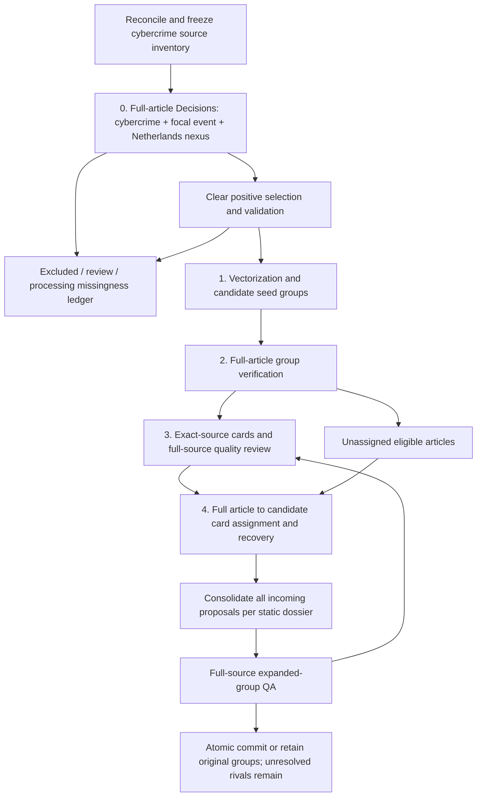

# Cybercrime NL workflow and execution status

Updated 23 October 2026. [Screening/export](RUN.md) is complete under its separate **$20 cap**, with five unresolved outcomes. The **$50 dossier run** uses registered [v9](DOSSIER_AMENDMENT_V9.md). At **22:18:17 Amsterdam**, the v10-capable observer confirmed the same actual Python worker **22952** running in article-to-card assignment at **784/2,746 request tasks**, with **$16.087693209 committed** and **26 holds**. These are request counts, not articles or dossiers. Seed-card review is finished; downstream processing and final audits remain incomplete. Details and qualified timing estimates are in [validation](VALIDATION.md) and [results](DOSSIER_RESULTS.md).

The user has authorized completion beyond the original deadline. The tested and reviewed [v10 extension](DOSSIER_AMENDMENT_V10.md) is **prepared but unregistered**. It will preserve that deadline as historical metadata and remove only the effective date cutoff after the current writer exits and a stopped report is bound. The healthy v9 worker remains untouched under its existing rules. All API caps, holds and no-retry identities remain unchanged. The authorized [final Codex CLI/account validation](FINAL_CODEX_VALIDATION.md) follows pipeline and audit completion; no validation sample, labels or precision/recall results exist yet.

## Sequence

Card updates and candidate recovery belong to processes 3 and 4; they are not additional stages. Screening and geography establish the selected analysis frame before grouping. Cards preserve each member's exact title and complete opening paragraphs. Full-source QA must confirm focus, group coherence and distinguishing evidence. Unclear or incoherent groups cannot become accepted memberships. The paired full-member comparison is diagnostic and cannot change assignments. V6 allows a complete, clear query with exactly one strong positive to propose membership while preserving uncertain rivals. All incoming proposals are checked together; failed expansion QA retains every original supported group and card.

| Stage | Existing basis | What remains |
| --- | --- | --- |
| Source frame | Full separate eight-bundle corpus frozen and exported: 61,089 records; 57,002 distinct requests, 3,775 aliases, 251 unavailable, 61 sealed. Dossier preparation retains 6,691 exact inputs representing 7,743 keep articles | Preserve this input and alias coverage through every stage |
| Screening | All 57,002 requests have stored responses: 56,997 valid and five unknown. Alias-expanded valid article routes: 7,743 keep, 47,790 exclude, 5,239 review | Evaluate semantic decisions against blinded article-based references; preserve unknown holds and no-retry rule; no AI-label reuse |
| Netherlands evidence | Independent third choice question implemented and dispatched | Validate against source-backed reference review; a model choice alone is not verified geographic evidence |
| 1. Candidate construction | Implemented full-input chunked embeddings, exact cosine and complementary word/character retrieval, bounded seed proposals; initial pilot stored 210 embedding responses | Preserve compatible results; measure actual shortlist recall, including delayed and multilingual reports |
| 2. Group verification | Full-article Decisions and complete-link partitioning; v5 Astra references: 12/12 same-event and clear, zero clear false merges. Two previously flagged articles/one group remain quarantined | Preserve old judgments and measure errors beyond adaptive samples |
| 3. Reference representation | V1–v4 generated-summary gates failed. V5 exact cards: 15/16 usable (93.75%); 10/10 selected Astra reviews supported. Census retains 83.83% of body tokens | Preserve this observed advance without treating a small adaptive reference sample as population accuracy |
| 4. Assignment/recovery | V5 accepted 0/12 withheld and 0/24 natural queries, so no assignment references exist. Both card/full-member arms evaluated all 12 withheld queries and accepted zero; route/clarity agreement 7/12 | Registered diagnosis: 18 complete single-positive queries were blocked by unresolved rivals. V6 passed: 3/3 expanded groups supported by Luna and Astra, 18 incoming articles accepted; all 12 secondary group hypotheses supported. V8 repairs the confirmed local stored-question-order error after the v7 interruption; after its source-card stop and passed audit, one unchanged continuation advanced, then stopped again at 796/1,145 source-card tasks. The subsequent v9 operational continuation finished the seed-card request queue and entered article-to-card assignment without a restart. Opaque causes remain unavailable and downstream coverage remains incomplete. Residual misses and population recall remain unmeasured |

No currently reported vector software test proves semantic candidate recall in this cybercrime frame. A similarity cutoff only proposes candidates; verification still decides identity. Provider seeds, exact-text proposals and lexical matches remain evidence routes rather than automatic accepted groups.

## Historical entrypoints

These references document existing operations, not commands to restart them. Their registered owners and prior authorization scopes remain binding.

| Purpose | Existing entrypoint / method |
| --- | --- |
| Calendar-year collection and extension | `scripts/collect_nl_cyber.py`, `scripts/backfill_nl_cyber.py`; [collection](evidence/docs/NL_CYBER_CALENDAR_COLLECTION.md) |
| Materialization and retrieval audit | `scripts/materialize_nl_cyber.py`, `scripts/audit_nl_cyber_retrieval.py`; same collection method |
| ID manifest comparison | `scripts/test_nl_cyber_id_manifest.py`; [ID proof](evidence/docs/NL_CYBER_ID_MANIFEST_TEST.md) |
| Saved event metadata diagnosis/repair | `scripts/check_nl_cyber_event_coverage.py`, `scripts/diagnose_nl_cyber_event_ids.py`, `scripts/repair_nl_cyber_event_metadata.py`; [metadata method](evidence/docs/NL_CYBER_EVENT_METADATA_COVERAGE.md) |
| Offline proposal generation | `scripts/match_nl_cyber_event_ids.py`; [matching diagnostic](evidence/docs/NL_CYBER_OFFLINE_EVENT_MATCHING.md) |
| Shared embedding/retrieval design | [embedding method](../shared/infrastructure/evidence/docs/OPENAI_EMBEDDINGS.md), [vector store](../shared/infrastructure/evidence/docs/FULL_CORPUS_VECTOR_STORE.md), [candidate search](../shared/infrastructure/evidence/docs/LOCAL_CANDIDATE_SEARCH.md) |
| Previous full-article assignment prototype | [prototype method](../ai_incidents/evidence/docs/LUNA_FULL_ARTICLE_DOSSIER_METHOD.md); not a complete summary-based cybercrime pipeline |

Shared runtime and gateway implementation remain under `src/newsresearch`; duplicating them into each study would risk divergent audit behavior. This folder owns the study specification, evidence references and new study-specific execution code. Private source text, model packets and operational ledgers remain in protected storage.

## Current dossier entrypoints

| Purpose | Study implementation |
| --- | --- |
| Exact screened input and alias freeze | [prepare_dossiers.py](runtime/prepare_dossiers.py) |
| Four-process execution, gate, accounting and export | Current frozen [run_dossiers_v9.py](runtime/run_dossiers_v9.py), [operational amendment](DOSSIER_AMENDMENT_V9.md), preserving the passed [v6 method](DOSSIER_AMENDMENT_V6.md); earlier versions remain preserved |
| Candidate search and conservative seed grouping | [dossier_candidates.py](runtime/dossier_candidates.py) |
| Full-text, exact-card and reference contracts | Current frozen [dossier_contract_v6.py](runtime/dossier_contract_v6.py), delegating unchanged full-source card QA to v5; earlier contracts remain preserved |
| Bounded audited transport | [dossier_transport.py](runtime/dossier_transport.py) |
| Independent summary diagnosis | [Original diagnostic](SUMMARY_DIAGNOSTIC.md), [schema repair](SUMMARY_DIAGNOSTIC_AMENDMENT_V2.md); nine valid reviews, three old holds; no summary regeneration or gate override |
| Separate read-only progress monitor | Active [check_dossier_progress_v10.py](runtime/check_dossier_progress_v10.py), currently observing v9; earlier observers preserved; actual observations in the [execution record](DOSSIER_RESULTS.md) |
| V7 capacity repair software and preparation | 99 focused checks and two independent reviews passed. Zero paid preparation calls: 80 prior seed attempts reused, 1,142 untouched requests fit, one packet deferred as unjudged (eight articles / 28 pairs). The later local question-order failure was separately diagnosed; v8 preserves this census |
| V9 operational continuation | 192 combined focused checks and independent reviews passed. Registration made zero model calls; same source/request/parser identities, all prior liabilities, durable health window and 30-second cooldown are bound |
| Prepared V10 execution extension | [Deadline-only amendment](DOSSIER_AMENDMENT_V10.md); 185 unique monitor cases and 13 runtime cases passed in their focused suites, with independent reviews. Execution remains unregistered; its observer is active against v9 |
| V8 order repair and local revalidation | 137 focused checks and two reviews passed; all 1,222 seed packets retain canonical identity, 462 maps reorder locally, three saved failures pass derived validation; zero registration model calls |
| V6 software and executed functional pilot | Focused suites and independent review passed; registered preparation made zero paid calls. Actual pilot passed all three primary groups, covering 18 incoming articles; 12/12 secondary hypotheses supported. This is adaptive model-reference evidence, not population accuracy |

The `monitor-cybercrime-dossiers` heartbeat runs every 30 minutes using the v10-capable observer, while the actual worker remains v9. It distinguishes actual worker state, durable health outcomes, provider responses, derived local checks, capacity deferrals, costs, processing completion and final audit coverage. Cooldown, stopped or stale workers have no live ETA. It includes the authorized safe v10 handoff after writer exit and subsequent Codex validation; neither has happened yet. The active launcher's method is [run_dossiers_v9_with_key.ps1](runtime/run_dossiers_v9_with_key.ps1); authorization and actual observations are in [DOSSIER_RESULTS.md](DOSSIER_RESULTS.md).

V9 registration preserved **2,607 provider responses**, **$14.008444966 committed** and **19 unresolved holds**: four from earlier pilots and 15 introduced during full v8 processing. The latest overview above preserves the distinction between request progress, costs and semantic coverage; full observations live in [DOSSIER_RESULTS.md](DOSSIER_RESULTS.md). Three derived local seed checks remain separate from provider responses. Earlier opaque transport causes are not claimed fixed; downstream work and final audits remain incomplete.

All **6,691 inputs** remain in scope. V7's seed census covers 5,755 distinct articles: 5,747 in fitting/reused packets and eight in one deferred packet, without overlap. Its **28 unasked comparisons** are unjudged/not attempted, not provider unknowns or extra holds. The other 936 inputs and deferred articles remain eligible for assignment/recovery; later success is not guaranteed. See [capacity evidence](VALIDATION.md#registered-v7-capacity-repair-and-startup) and [v8 validation](VALIDATION.md#registered-v8-order-repair-and-startup).

## Current screening entrypoints

| Purpose | Study implementation |
| --- | --- |
| Exact questions, choices and routing | [screening_contract.py](runtime/screening_contract.py) |
| Frozen preparation, requests, accounting and report | [run_screening.py](runtime/run_screening.py) |
| Active continuation with preserved zero-cost preparation lineage | [run_screening_v2.py](runtime/run_screening_v2.py) |
| Saved-key launcher | [run_with_key_v2.ps1](runtime/run_with_key_v2.ps1); credentials remain outside logs |
| Source partition proof | [verify_partition.py](runtime/verify_partition.py) |
| Separate read-only progress monitor | [check_progress.py](runtime/check_progress.py); [monitoring rules](RUN.md#monitoring-and-continuation) |

Preparation, registration, focused software checks, the 100-request operational gate, queued screening and final export are complete. The gate tested transport/schema/usage and affordability, not real-article classification accuracy. The final report was verified at 14:28:52 Amsterdam on 23 October with no live worker. Five unknown outcomes, 251 unavailable records and 61 sealed records remain outside valid classification coverage. Source-based screening and Netherlands-reference validation remain outstanding. Count stored responses separately from valid classifications and accepted memberships.

Screening commitment is **$14.48956127 / $20**, including $3 held. Dossier processing has its separate **$50 cap: $35 main / $15 audit / $0 unallocated**, preserving prior subcaps, all liabilities and the original deadline. It cannot resend attempted requests, including summaries for the same dossier revision or audited pairs under changed instructions. Standalone card capacity does not establish assignment/QA capacity or full-run affordability. The AI dossier budget and earlier collection/screening allowances remain separate. Preserve historical identities and STOPs; no collection or source refetch is implied.
