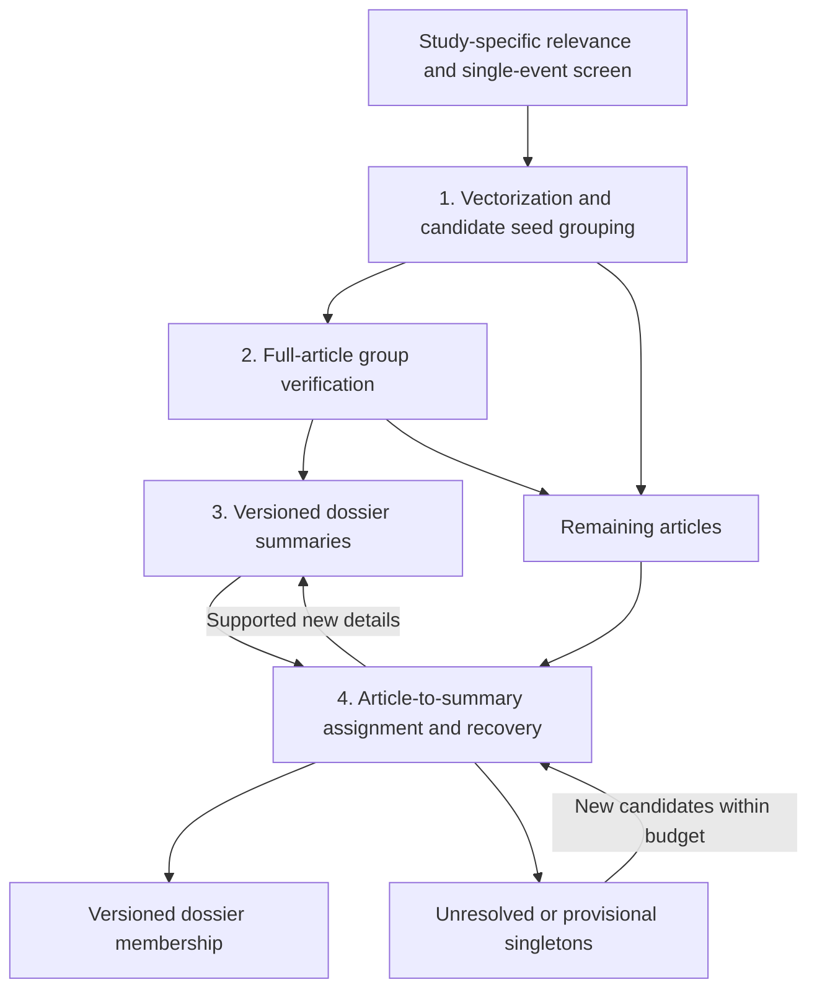

# Four dossier processes

23 October 2026. Current shared design; no completed end-to-end dossier run is
claimed. The [definition](DEFINITION.md) sets the generic unit. Each investigation
binds its own relevance, geographic scope, corpus, clarity policy and budget.

## Selection comes first

Keep only articles that clearly satisfy the study's topic criteria and have one
focal event. Background references are allowed; coequal independent events,
topic overviews and unresolved focus are not assigned as whole articles. Keep
their original labels and exclusion reasons. Technical failures remain unknown,
not substantive exclusions. An article has at most one primary event dossier.

## 1. Vectorization, retrieval and seed proposals

**Input:** frozen eligible source versions, retained full text and any reusable
vectors with matching source hashes and embedding profiles.

Build multilingual article/passage retrieval and complementary lexical or entity
search. Preserve passage provenance and report missing/failed embeddings. A model
input limit must not silently truncate articles: use documented passage coverage
or leave the source unresolved. Existing vectors are reusable only after exact
coverage and version checks, not merely because the article count looks similar.

Propose tight groups from stronger similarities. A calibrated cutoff controls
which proposals are worth checking; it never proves event identity. Lower scores,
isolated articles and unmatched sources stay in the assignment queue. Avoid a
hard date window that hides delayed reporting, and never treat provider event IDs
as reference truth. Bound and deduplicate candidate comparisons without hiding
the comparisons not made.

**Output:** candidate edges/groups, their discovery routes and scores, plus a
complete remainder manifest. No accepted dossier exists at this step.

**Validation:** independently labeled same-event pairs recovered at the shortlist
size, by language, delay and reporting frequency. Numerical nearest-neighbor
correctness and semantic retrieval recall are different checks. No bounded
retrieval method guarantees discovery of every possible match.

## 2. Verify seed groups with full articles

**Input:** proposed groups and complete original articles, with exact versions.

Luna Decisions evaluates the focal events under the shared definition, retaining
same-event, related-but-distinct, different and uncertain outcomes. A decision
request may batch questions when the transport allows it; question count, request
count and input tokens must be reported separately. Model choice probabilities
are not calibrated correctness probabilities without a dedicated evaluation.

Require the declared within-group consistency checks before retaining a seed.
A-B and B-C matches alone cannot justify merging A with C. Split or defer conflicts;
do not force a single group from a connected component. Unreadable or oversized
inputs remain explicit, with no silent replacement or truncation.

**Output:** verified provisional seed groups, pair evidence and unassigned sources.
"Verified" identifies the performed model checks; it does not imply human truth.

**Validation:** source-based reference review of false merges, missed joins,
uncertainty and coverage. Report group-level purity and fragmentation as well as
pair outcomes; many pairs from one event are not independent observations.

## 3. Generate and maintain dossier summaries

**Input:** a verified group and its retained sources. A clear singleton can receive
a separate provisional summary labeled `single_source`; it is not a verified
multi-article group.

Use ordinary text generation, not fixed-choice Decisions, to produce a concise
event overview and structured identity record. Preserve the focal action and
scope, participant roles and aliases, affected object, event time/place with
precision, status and consequences, distinguishing identifiers, boundaries,
unknowns, contradictions and claim-level source/passage references. Planned or
alleged events must not become asserted facts through summarization.

Check schema, source membership, reference validity and completeness mechanically;
independently review semantic faithfulness and omitted identifying facts. Retain
all source coverage if a large dossier needs multiple generation batches. A failed
summary cannot serve as a matching reference. The earlier 400–700-token target
is a planning assumption, not a validated length or permission to remove identity.

**Output:** immutable summary version/hash, membership revision, source manifest,
prompt/model version and generation attempt. Preserve previous versions.

**Validation:** unsupported claims, missing distinguishing evidence, changed
identity and resulting match decisions versus the original source set.

## 4. Assign remaining articles and recover missed candidates

**Input:** one full incoming article and candidate dossier summaries from step 3.
Retained member vectors and lexical indexes remain additional retrieval routes;
summaries do not replace every discovery signal.

Luna Decisions compares the incoming article with each candidate's event identity.
Accept only the prescribed positive, unambiguous outcome. Missing summary details
do not count as agreement. Two accepted candidates create a conflict to resolve;
no candidate accepted in a bounded shortlist does not prove a new event.

Bind the result to the exact article and summary versions. Reject stale writes;
never attach an old decision to an unseen updated summary. Preserve uncertainty.
If evidence is inadequate, keep the item unresolved or as an explicitly provisional
singleton, and try additional discovery routes within the registered recovery budget.
Do not automatically retry an attempted model request.

Supported new details return to step 3 for a versioned update. Duplicate reporting
may add provenance without regenerating prose. Identity-changing corrections
require explicit review and checks of affected prior assignments. Recovery and
summary maintenance are loops within these four processes, not additional stages.

**Output:** versioned memberships, related-event links, singletons/unresolved items,
costs and a complete coverage ledger. Summary-based assignment is distinguished
from full-member pair verification; it does not inherit an all-pairs guarantee.

**Validation:** actual retained membership precision, fragmentation, unresolved
coverage and event coverage, with uncertainty intervals. Audit summary decisions
against original articles. Never remove ambiguous reference cases after seeing
them merely to improve the precision denominator.

## Execution gates

Before spending, register the frozen selection, definition, prompts, output schema,
retrieval rules, probability policy, audit sample, cost reservations and stop rules
through the [shared runtime](../infrastructure/README.md). Use an embedded pilot
to calibrate costs and detect failures, then freeze the method before held-out
evaluation. Adaptive development results are not held-out evidence.

The full AI workflow, including embedding work, pilot, summary generation/updates,
assignment, recovery and limited audit, must fit its $20 cap. Its current envelope
is $3 vector work, $12 combined Luna work, $3 reference audit and $2 contingency;
these are planning allocations, not measured prices or guaranteed full coverage.
The completed cybercrime screening has its own $20 cap. The user separately
authorized applying these four dossier processes to its retained selection under
a new $50 total cap, including vector work, pilot, verification, summaries,
assignment, recovery and audit. Its preparation and execution gates remain
separate from the AI study and the completed cybercrime screen.
No current result establishes that all four processes meet the research target.
